<div align="center">

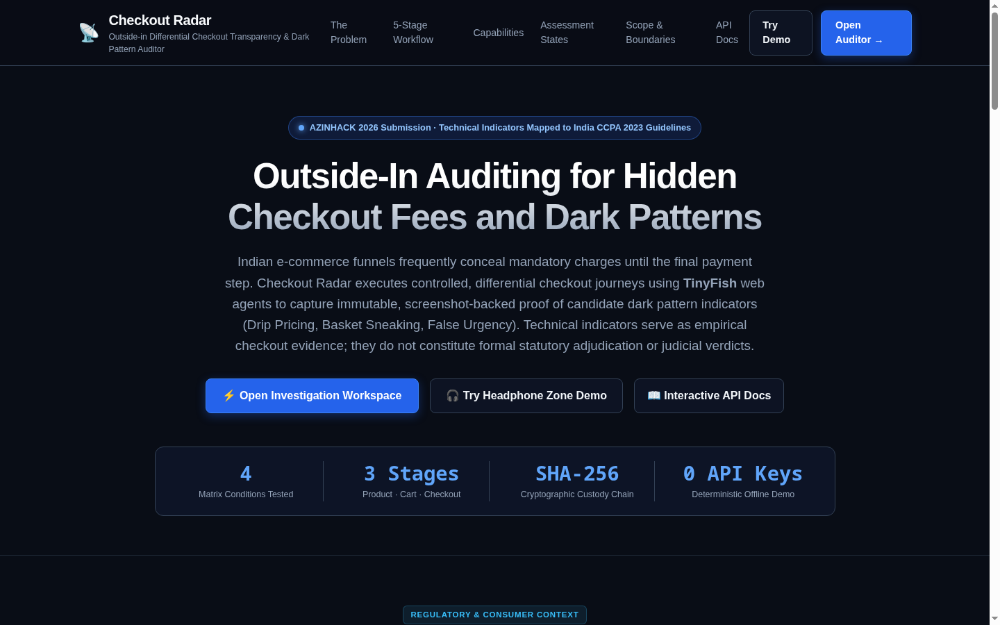

<h3>Checkout transparency built on evidence, not claims.</h3>

<p>Audit e-commerce funnels from the outside in. Deploy autonomous browser agents across controlled condition matrices to capture immutable, SHA-256 hashed proof of dark patterns mapped directly to India's CCPA 2023 Guidelines.</p>

<a href="http://localhost:8000/auditor"></a>

<p><sub>AZINHACK 2026 Submission · 100% Deterministic Offline Mock by Default · Zero External API Keys Required to Run or Test · Non-Destructive Stop-Before-Payment Guarantee</sub></p>

    <br>
    <br>
   

<p><a href="#the-experience">Experience</a> · <a href="#the-product-as-a-skeleton">Skeleton</a> · <a href="#the-pipeline">Pipeline</a> · <a href="#behind-the-product">Pitch</a> · <a href="#engineering-map">Engineering</a> · <a href="#local-development">Development</a></p>

</div>

---

## The experience

Checkout Radar puts consumers, consumer rights advocates, journalists, researchers, and compliance officers on one empirical auditing platform. A checkout URL becomes itemized fee extractions across three critical stages; fee inflation is proven by a mathematical matched-pair diff; statutory dark patterns are mapped directly to India's CCPA 2023 Gazette Notification; and every fee links to an immutable SHA-256 cryptographic screenshot hash.

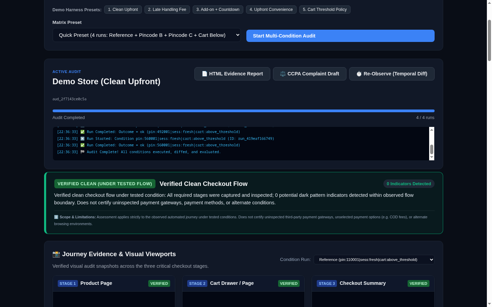

<a href="http://localhost:8000/auditor">
  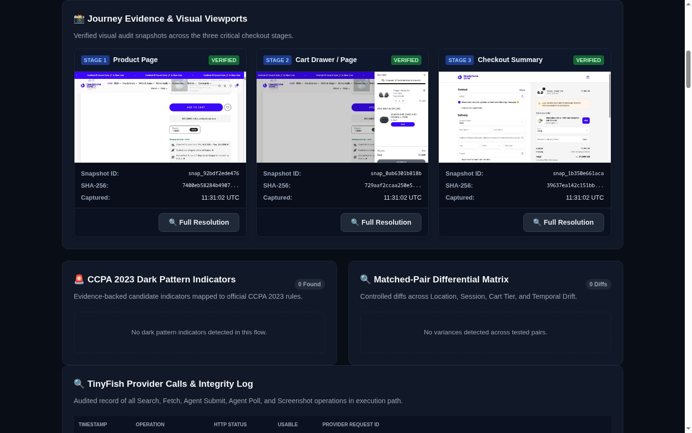
</a>

*Live-site screenshot. Click to open the workspace. Pre-seeded demo fixtures illustrate the complete forensic workflow.*

| Prove what is charged | Diff what changes | Enforce the CCPA standard |
| :--- | :--- | :--- |
| Autonomous browser agents capture 1280×720 viewports of the **Product Page**, **Cart Drawer**, and **Checkout Summary**; every fee comes back with the exact stage that first revealed it. | Matched pairs hold all variables constant while isolating **Location** (pincodes), **Session History** (fresh vs returning), **Cart Threshold**, or **Time**. | Mandatory fees hidden upfront become **Drip Pricing** (Annex 1.8); pre-ticked add-ons become **Basket Sneaking** (Annex 1.2); resetting timers become **False Urgency** (Annex 1.1). |
| Labels stay honest: *Live Viewport (1280×720)*, *Synthetic Fixture (Offline DOM)*, *Uninspected Flow*. | Recipe family logic prevents cart threshold discounts from being mistaken for price variance. | Conservative fail-closed assessment: missing stages or bot blocks report **Inconclusive**, never an unearned clean bill. |

### Four ways across the funnel

**Every audit tests the exact same recipe family** and systematically perturbs one variable at a time:

| Dimension | Tested variation | Controlled across | Isolated effect |
| :--- | :--- | :--- | :--- |
| **Location** | Tier-1 Metro (110001) vs Tier-2/3 (492001, 560001) | Session state, cart tier, recipe family | Pincode delivery surcharge & regional convenience fee |
| **Session** | Fresh guest profile vs Returning user | Pincode, cart tier, recipe family | Personalized pricing & repeat-buyer fee surges |
| **Cart threshold** | Above threshold (₹998) vs Below threshold (₹499) | Pincode, session state, item unit price | Legitimate small-cart rules vs hidden fee inflation |
| **Temporal drift** | Initial observation ($t_0$) vs Scheduled re-run ($t_1$) | All conditions, identical recipe | Time-based dynamic surge pricing & fee creep |

Nobody can disguise a fee: the engine isolates each variable in integer minor units while holding all other factors constant.

### Trust is part of the interface

- **Math, not guesses:** every extraction is validated against $\text{Subtotal} + \text{Charges} + \text{Taxes} - \text{Discounts} = \text{Final Payable}$ in integer minor units (paise). If a single rupee is unaccounted for, the run is quarantined as `extraction_inconsistent` and excluded from diffs.
- **Hashes, not claims:** every fee cites the exact stage sequence where disclosure was absent, linked to an immutable SHA-256 cryptographic digest of the redacted viewport capture.
- **Fail-closed, not clean by default:** if an audit encounters an SMS OTP wall or Cloudflare Turnstile challenge, the engine reports `blocked_by_login` or `blocked_by_bot` and renders an amber **`INCONCLUSIVE AUDIT`** verdict. Missing evidence is never treated as proof of innocence.
- **The Non-Destructive Invariant:** agents are bound by hard negative prompts: **`STOP IMMEDIATELY BEFORE ANY FINAL PAYMENT OR ORDER CONFIRMATION STEP. NEVER CLICK PAY NOW, COMPLETE ORDER, OR SUBMIT PAYMENT.`** Zero inventory held, zero financial credentials entered.
- **Zero exfiltration:** API keys (`TINYFISH_API_KEY`, `LLM_API_KEY`) reside exclusively in the backend SQLite key-value store or environment variables. They are never rendered into HTML attributes, JavaScript variables, browser storage, or exported audit reports.
- **Rules in the engine, not the prompt:** candidate indicators are produced upstream by deterministic diff rules; the LLM strictly classifies and contextualizes under regex guardrails. If the model is unavailable or rate-limited, deterministic statutory templates take over seamlessly.

---

## The product, as a skeleton

One loop through the forensic auditor workspace, stripped to its structure.

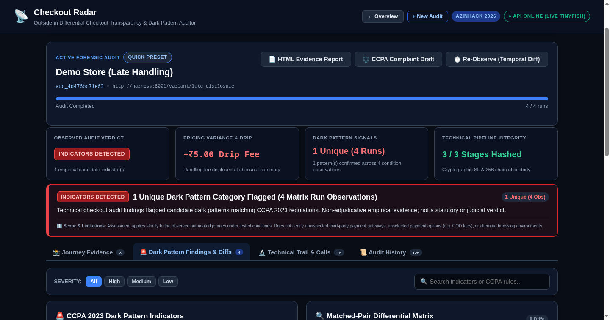

| | Step | What the interface does |
| :---: | :--- | :--- |
| **1** | **Target intake** | Enter a direct product URL or select a preset; choose a matrix preset (`Single`, `Quick` 4-run, or `Full` 12-run). |
| **2** | **Live telemetry** | Watch the Server-Sent Events (SSE) console stream real-time agent steps (`search`, `fetch`, `agent_submit`, `agent_poll`). |
| **3** | **Inspect viewports** | The 3-stage gallery loads high-res viewports for **Product**, **Cart**, and **Checkout Summary** with `.copy-pill` SHA-256 hashes. |
| **4** | **Review diffs & findings** | Scorecard displays exact rupee variance; deduplicated findings cards show matrix reproduction rates (e.g. *Observed in 4 of 4 Runs*). |
| **5** | **Export dossier & complaint** | Click **HTML Evidence Report** for a standalone offline dossier, or **CCPA Complaint Draft** for an editable NCH grievance. |

---

## The pipeline

Capturing checkout journeys and classifying dark patterns are separate paths. The stored evidence connects them.

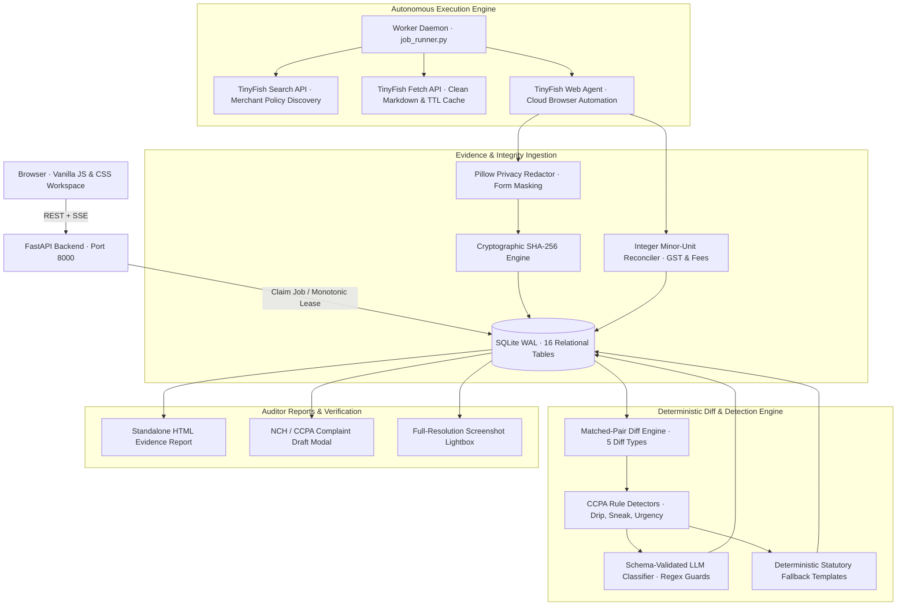

**Open any stage** to see what happens inside it.

<details>
<summary><b>01 · Discovery</b> — merchant policy and terms extraction via TinyFish Search</summary>
<br>

- **What happens:** queries `https://api.search.tinyfish.ai/?query={merchant}+pricing+terms+cancellation` to discover declared terms of service, fee disclosures, and return policies before entering the checkout funnel.
- **Carries forward:** merchant domain, official terms URLs, and initial pricing declarations.
- **Where to look:** `backend/app/tinyfish/real_client.py` (`search_merchant_policies`), `backend/app/worker/job_runner.py`
</details>

<details>
<summary><b>02 · Extract</b> — cached markdown policy extraction via TinyFish Fetch</summary>
<br>

- **What happens:** invokes `https://api.fetch.tinyfish.ai` to crawl discovered terms pages. Applies TTL freshness rules (`ttl: 0` for live pricing, `ttl: 3600` for legal terms) to prevent unnecessary upstream requests while maintaining clean markdown extracts.
- **Carries forward:** raw policy text stored in `fetches` table.
- **Where to look:** `backend/app/tinyfish/real_client.py` (`fetch_page_content`), `backend/app/db/crud.py`
</details>

<details>
<summary><b>03 · Navigate</b> — autonomous web agent with stop-before-payment guardrail</summary>
<br>

- **What happens:** dispatches headless cloud web agents via `POST https://agent.tinyfish.ai/v1/automation/run-async` with structured goal instructions: navigate to product display page, record price and delivery promises, add item to cart, open cart drawer, record subtotal and add-ons, proceed to guest checkout, input target delivery pincode, and stop immediately upon loading order review.
- **Hard Guardrail:** negative prompt explicitly forbids clicking "Complete Order", "Pay Now", or entering financial credentials.
- **Where to look:** `backend/app/tinyfish/goals.py` (`build_checkout_goal`), `backend/app/tinyfish/real_client.py`
</details>

<details>
<summary><b>04 · Redact & Hash</b> — Pillow privacy masking and SHA-256 digest</summary>
<br>

- **What happens:** downloads raw step viewport captures (1280×720). Passes image bytes to `redactor.py` which applies a solid fill mask over the bottom 5% of the viewport (protecting sticky session IDs and cookies) and supports targeted coordinate bounding boxes for form inputs. The final redacted JPEG is hashed with SHA-256 and saved as `run_{id}_{step}_{sha256[:12]}.jpg`.
- **Carries forward:** immutable `snapshots` and `stage_captures` database records.
- **Where to look:** `backend/app/worker/redactor.py`, `backend/app/worker/job_runner.py`
</details>

<details>
<summary><b>05 · Reconcile</b> — integer minor-unit arithmetic verification</summary>
<br>

- **What happens:** converts all rupee strings into integer paise ($\text{₹}14.99 \rightarrow 1499$). Validates arithmetic against:
  $$\text{Subtotal} + \sum \text{Charges} + \text{Taxes} - \text{Discounts} = \text{Final Payable}$$
  Also validates Indian tax-inclusive GST retail models where taxes are included in unit prices.
- **Carries forward:** `total_reconciliations` database record with `is_reconciled` boolean.
- **Where to look:** `backend/app/analysis/reconciler.py`, `backend/app/analysis/normalizer.py`
</details>

<details>
<summary><b>06 · Diff</b> — matched-pair differential engine across 5 diff types</summary>
<br>

- **What happens:** groups runs into matched pairs that differ in *exactly one requested parameter*:
  1. `LATE_DISCLOSURE`: mandatory charge appeared at checkout summary while verified absent at product stage.
  2. `UNDISCLOSED_AT_STAGE`: fee not visible at earlier verified stages.
  3. `PRICE_VARIANCE`: fee or unit price varies between matched pincodes or fresh vs returning profiles.
  4. `SMALL_CART_RULE`: fee present only on below-threshold cart tier (distinguished from unfair pricing).
  5. `TEMPORAL_DRIFT`: price changes across time intervals $t_0 \rightarrow t_1$ for identical conditions.
- **Carries forward:** structured `diffs` database records.
- **Where to look:** `backend/app/analysis/diff_engine.py`
</details>

<details>
<summary><b>07 · Detect</b> — CCPA 2023 Gazette statutory rule mapping</summary>
<br>

- **What happens:** deterministic detectors match diffs against statutory rules from `data/ccpa_definitions.json`. Flags Drip Pricing (Annex 1.8), Basket Sneaking (Annex 1.2), and False Urgency (Annex 1.1) with confidence scores and reproduction metrics.
- **Carries forward:** candidate `findings` records with severity, confidence, and CCPA Annex citations.
- **Where to look:** `backend/app/analysis/detectors.py`
</details>

<details>
<summary><b>08 · Explain</b> — schema-validated LLM contextualizer with fallback</summary>
<br>

- **What happens:** an LLM classifier (`openai/gpt-oss-20b` via Groq) contextualizes findings under strict regex guards: prohibited legal words (`guilty`, `convicted`, `unlawful`) are blocked; evidence grounding ensures absence claims cite explicit `not_observed_verified` records; if rate-limited (`HTTP 429`), deterministic statutory templates take over seamlessly.
- **Carries forward:** human-readable non-judicial explanation and statutory notes.
- **Where to look:** `backend/app/analysis/classifier.py`
</details>

<details>
<summary><b>Full system diagram</b> — every service and store, in one view</summary>
<br>

```text
[ Browser Dashboard ] ─── REST + SSE ───► [ FastAPI Application ] ──► [ SQLite WAL Database ]
                                                 │ enqueue                    ▲
                                          [ Durable Jobs ] ───────────────────┘
                                                 │ claim (monotonic lease)
                  ┌──────────────────────────────┴──────────────────────────────┐
                  ▼                                                             ▼
         [ Matrix Orchestrator ]                                        [ Worker Daemon ]
                  │                                                             │
                  ├─► TinyFish Search (Policy Discovery)                        ├─► Pillow Privacy Redactor
                  ├─► TinyFish Fetch (Cached TTL Policies)                      ├─► SHA-256 Custody Hasher
                  └─► TinyFish Agent (Async Cloud Browser)                      ├─► Minor-Unit Reconciler
                                                                                ├─► Matched-Pair Diff Engine
                                                                                ├─► CCPA Rule Detectors
                                                                                ├─► Guarded LLM Classifier
                                                                                └─► HTML Dossier & NCH Draft
```

</details>

The diff engine detects; the model only contextualizes. The integer arithmetic, deterministic rule detectors, and cryptographic hashes make results checkable and repeatable, but a single run can still be an anomaly: that is why *Matrix Reproduction Rates* are reported (e.g. *Observed in 4 of 4 Runs*), and findings remain technical indicators rather than judicial verdicts.

---

## Behind the product

Core mechanisms from the Checkout Radar pitch deck. They explain the architectural principles with verified demonstration data; the pipeline above describes the implementation.

<table>
<tr>
<td width="33%">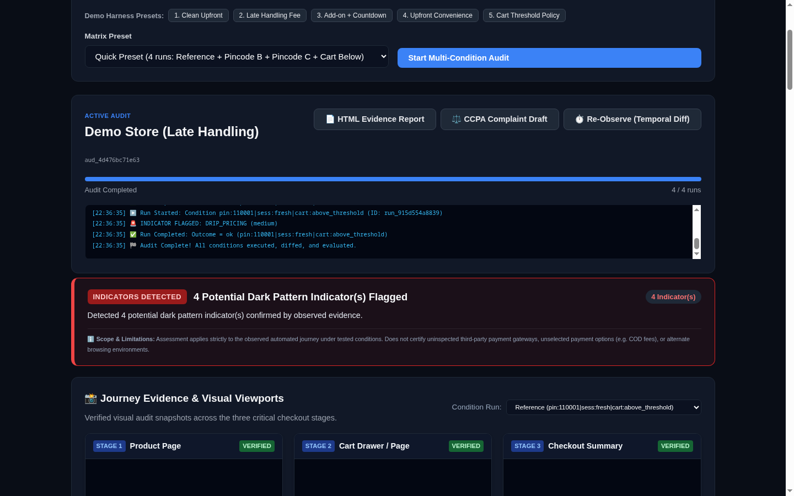</td>
<td width="33%">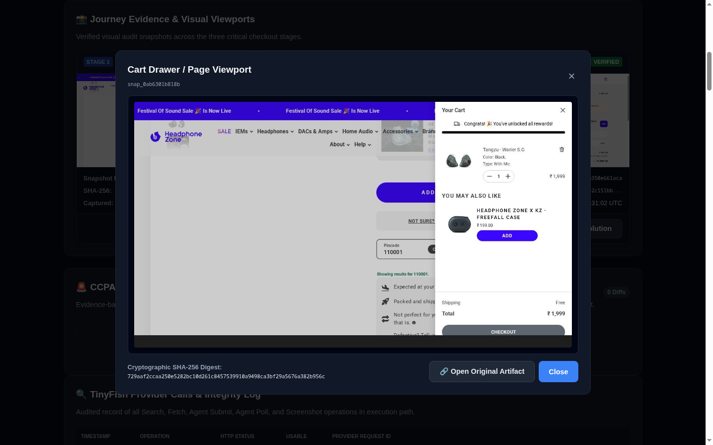</td>
<td width="33%">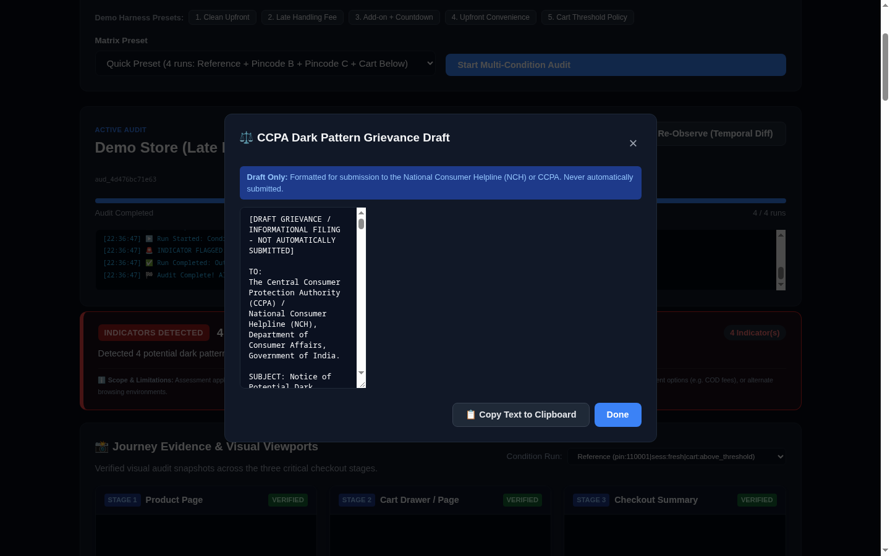</td>
</tr>
<tr><td align="center"><b>The agent browses, Python diffs</b></td><td align="center"><b>Hashes, not unverified claims</b></td><td align="center"><b>Rules live in the engine</b></td></tr>
</table>

<details>
<summary><b>See the full deck outline</b> — ten slides · <a href="docs/SLIDES_AZINHACK.md">Slide Markdown</a></summary>
<br>

| Concept & Problem | | | |
| :---: | :---: | :---: | :---: |
| **01 · Cover**<br>Outside-In Differential Checkout Transparency | **02 · Problem**<br>Hidden handling, surge & platform fees | **03 · Solution**<br>Differential condition matrices | **04 · Users**<br>Consumers, journalists, compliance |

| Engine & Architecture | | | |
| :---: | :---: | :---: | :---: |
| **05 · Cart Invariant**<br>Recipe family vs. cart instance | **06 · TinyFish**<br>Search, Fetch, Agent, Profiles | **07 · Reliability**<br>Lease fencing & integer math | **08 · Evaluation**<br>3-Tier benchmark framework |

| Harness & Future | |
| :---: | :---: |
| **09 · Harness**<br>5 reproducible merchant variants | **10 · Future**<br>Browser extension & global proxies |

</details>

<details>
<summary><b>See live audits and dark pattern detections in motion</b></summary>
<br>


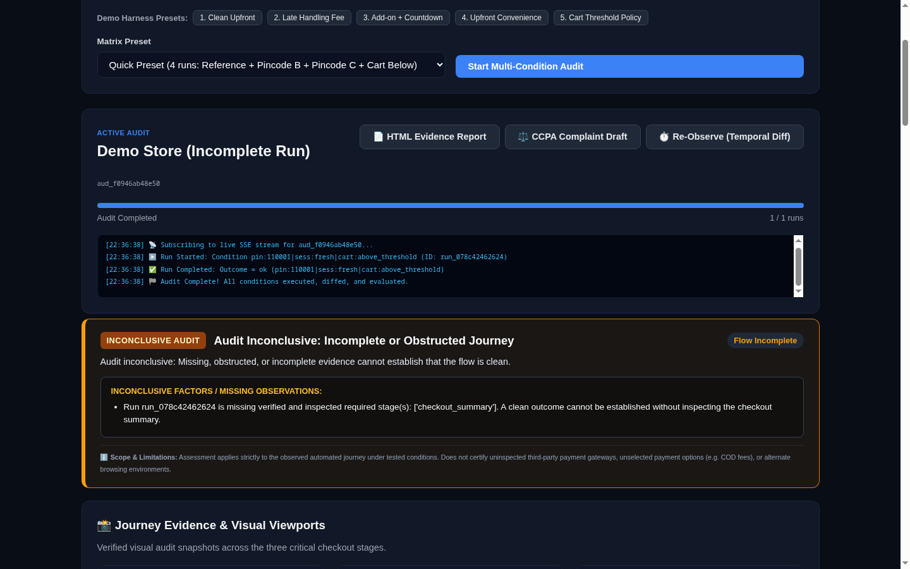

</details>

<details>
<summary><b>See more of the live app</b></summary>


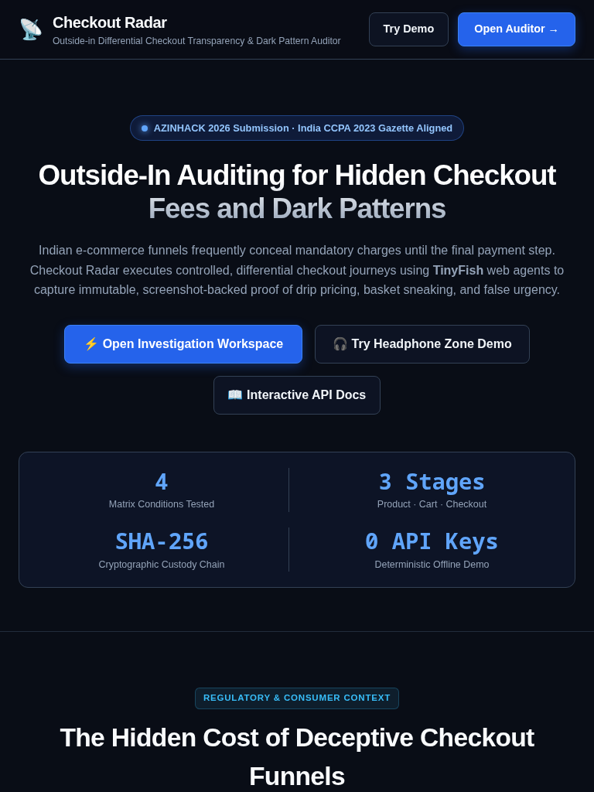

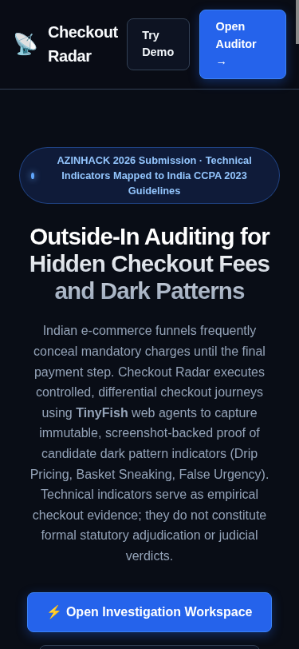

</details>

---

## Engineering map

| Layer | Implementation |
| :--- | :--- |
| **Interface** | `frontend/` — Vanilla HTML5, CSS3, ES2022 JavaScript. Responsive layouts (Desktop 1440×900, Tablet 768×1024, Mobile 375×812). Zero node_modules or frontend build steps. |
| **API and access** | FastAPI with Pydantic models as the contract; Server-Sent Events (SSE) progress feed with `last_event_id` reconnection; 15 REST operations in [`docs/api-contract.md`](docs/api-contract.md), checked by tests. |
| **Data and rules** | SQLite 3 in WAL mode (`PRAGMA journal_mode = WAL;`): 16 relational tables with foreign key enforcement and 30,000ms busy timeout. |
| **Concurrency** | Durable job queue with **monotonic lease fencing tokens** (`lease_generation`) inside `BEGIN IMMEDIATE` transactions to prevent split-brain worker overwrites. |
| **Agent engine** | Dual-mode TinyFish adapter: `MockTinyFishClient` (deterministic offline replay) and `RealTinyFishClient` (Search, Fetch, Agent run-async, Profiles, Screenshots). |
| **Diff and detection** | Deterministic matched-pair diff engine (5 diff types), CCPA rule detectors (Annex 1.8, 1.2, 1.1), integer minor-unit arithmetic reconciler, and guarded LLM classifier. |
| **Trust and custody** | Pillow privacy masking (bottom-5% footer mask + targeted bounding boxes) and SHA-256 cryptographic image hashing. |
| **Delivery** | Minimal Alpine Docker images (`backend/Dockerfile`, `harness/Dockerfile`), native `./start.sh` and `start.cmd` launcher scripts with dynamic port resolution. |
| **Verification** | 114 backend unit tests, 3 live journey demo verifications, 5 CDP browser interaction checks, and dedicated 11-pattern secret scanner. |

<details>
<summary><b>Repository layout</b></summary>

```text
backend/
  app/main.py            App factory: routes, CORS, SSE progress stream, static mounting
  app/analysis/          diff_engine (5 types), detectors (CCPA rules), normalizer, reconciler, classifier
  app/db/                connection (WAL mode), crud (atomic observations), schema.sql (16 tables)
  app/matrix/            orchestrator (single, quick [4 runs], full [12 runs] condition expansions)
  app/models/            contracts (TinyFish JSON contract), schemas (Pydantic models = API contract)
  app/reports/           html_report (exportable dossier), complaint_draft (NCH / CCPA grievance draft)
  app/services/          settings_service (backend credentials store, zero-exfiltration masking)
  app/tinyfish/          mock_client (offline replay), real_client (Search, Fetch, Agent), goals (guardrails)
  app/worker/            daemon (loop), job_runner (lease recovery), redactor (Pillow mask & SHA-256)
  tests/                 114 unit, integration, concurrency, and security tests
frontend/
  index.html             Product landing page: overview, 5-stage workflow, CCPA mapping, demo cards
  auditor.html           Forensic auditor workspace: hero scorecard, 3-stage gallery, lightbox, diffs
  app.js                 State management, SSE live console, findings deduplication, copy utils
  styles.css             Forensic dark theme tokens, responsive breakpoints, copy pills
  landing.css            Landing page specific layouts, hero metric strip, cards
harness/
  app.py                 5-variant reproducible merchant server (Clean, Late Fee, Add-on, Upfront, Threshold)
data/
  ccpa_definitions.json  All 13 CCPA 2023 Gazette dark pattern definitions & official Annex citations
  demo_seed.json         Pre-seeded demonstration audit fixtures (instant demo without API keys)
  checkout_radar.db      SQLite database in WAL mode (append-only evidence store)
  evidence/              Redacted viewport captures (SHA-256 hashed JPEGs)
evaluation/
  ground_truth.json      45 curated synthetic scenario bundles (15 clean, 12 drip, 10 sneak, 8 urgency)
  last_run_telemetry.json Durably recorded provider run telemetry (N=30 candidates, gpt-oss-20b via Groq)
  run_evaluation.py      Three-tier benchmark runner with confusion matrices & latency breakdown
scripts/                 launcher, verify_demo_flows, verify_ui_interaction, scan_secrets, stress_test
docker-compose.yml       3-tier container orchestration (harness: 8001, api: 8000, worker)
start.sh / start.cmd     One-command cross-platform startup scripts
stop.sh / stop.cmd       Clean container teardown scripts
```

</details>

### Boundaries that matter

The backend worker coordinates jobs with **monotonic lease fencing tokens**, so stale workers that wake up after a lease timeout are rejected with `StaleLeaseError`, guaranteeing that multiple workers never corrupt the same audit run. Resets and retries execute inside atomic `BEGIN IMMEDIATE` transactions with observation idempotency.

The live build uses sample data and a deterministic offline mock by default. Real TinyFish agent executions navigate genuine live stores, but adhere to the strict **Stop-Before-Payment** boundary: no merchant inventory is held and zero financial transactions are submitted. All API credentials reside exclusively on the backend with automated regex scrubbing across all logs and responses.

---

## Local development

You need Python 3.12+ and Docker Engine with Docker Compose (v2.20+ or Docker Desktop).

```bash
# 1. Clone the repository
git clone https://github.com/patchyevolve/CheckOutRadar.git
cd checkout-radar

# 2. Launch with a single command (auto-detects Docker, generates .env, starts containers)
./start.sh              # On Linux & macOS
start.cmd               # On Windows (CMD / PowerShell)

# Or launch directly with Docker Compose:
docker compose up --build -d
```

Without `TINYFISH_API_KEY` or `LLM_API_KEY`, Checkout Radar runs in **100% deterministic offline mock mode**: all 5 merchant harness variants, pre-seeded demonstration audits, and the full test suite work out of the box with zero external credits. Configure real keys at any time via the workspace **`⚙️ Provider Settings`** modal.

<details>
<summary><b>Checks</b> — backend tests, demo flows, and security scan</summary>

```bash
# Backend — 114 unit, integration, and concurrency tests (zero network calls)
PYTHONPATH=backend pytest backend/tests/ -v

# Demo flows — automated verification of all 3 core demonstration scenarios
python3 scripts/verify_demo_flows.py

# Browser CDP — automated headless browser & lightbox verification
python3 scripts/verify_ui_interaction.py

# Security — dedicated secrets audit scanner across 147 files and full git log
python3 scripts/scan_secrets.py

# Concurrency — multi-process SQLite WAL contention & lease stress test
python3 scripts/stress_test_multiprocess.py
```

</details>

For deeper context: [presentation slides](docs/SLIDES_AZINHACK.md), [real-site validation protocol](docs/REAL_SITE_VALIDATION_PROTOCOL.md), and [TinyFish Day-0 spike report](docs/SPIKE_REPORT.md).

---

<div align="center">

<p><strong>Built for AZINHACK 2026</strong></p>

Checkout transparency built on evidence, not claims.

<a href="http://localhost:8000/auditor"></a>

<sub>© 2026 Checkout Radar. Screenshots and animations show the live hackathon build with sample data.</sub>

</div>
