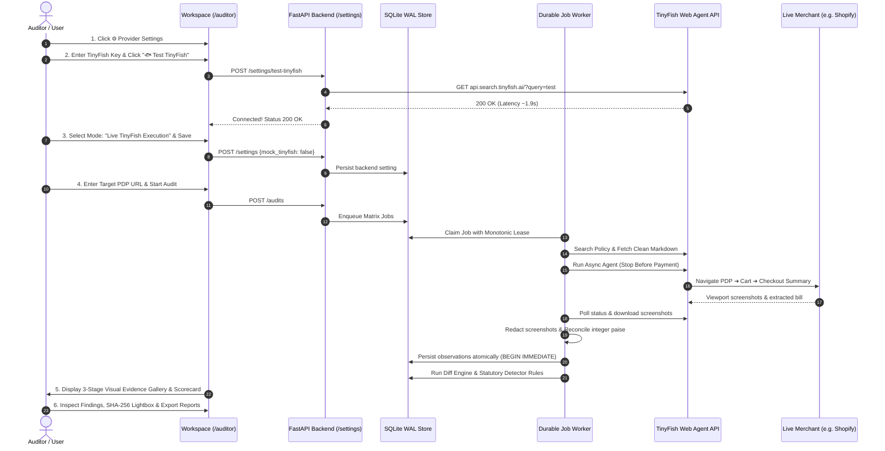

<div align="center">

# 📡 Checkout Radar

### Outside-in auditing for hidden checkout fees, not unverified claims.

<p>Audit e-commerce checkout funnels from the outside in. Deploy autonomous browser agents across controlled condition matrices (pincodes, sessions, cart thresholds, and time) to capture immutable, SHA-256 hashed evidence of dark patterns mapped directly to India's CCPA 2023 Guidelines.</p>

<p>
  <a href="#the-experience"><b>The Experience</b></a> · 
  <a href="#the-product-as-a-skeleton"><b>Product Skeleton</b></a> · 
  <a href="#the-pipeline"><b>8-Stage Pipeline</b></a> · 
  <a href="#the-method-and-condition-matrix"><b>The Method</b></a> · 
  <a href="#engineering-map"><b>Engineering Map</b></a> · 
  <a href="#evaluation-and-benchmarks"><b>Evaluation</b></a> · 
  <a href="#local-development-and-quickstart"><b>Quickstart</b></a> · 
  <a href="#live-merchant-auditing-guide"><b>Live Auditing</b></a>
</p>

<p><sub>AZINHACK 2026 Submission · 100% Deterministic Offline Mock by Default · Zero External API Keys Required to Run or Test · Non-Destructive Stop-Before-Payment Guarantee</sub></p>

[](https://www.python.org/)
[](https://fastapi.tiangolo.com/)
[](https://www.sqlite.org/)
[](https://tinyfish.ai/)
[](docker-compose.yml)
[](backend/tests/)
[](scripts/verify_demo_flows.py)
[](scripts/scan_secrets.py)
[](LICENSE)

</div>

---

## The experience

Indian e-commerce and quick-commerce checkouts routinely conceal fees—handling fees, packaging charges, platform convenience fees, surge charges, and small-cart penalties—until the consumer has already invested time navigating the funnel. 

While the **Central Consumer Protection Authority (CCPA)** notified dark pattern guidelines under the *Consumer Protection Act, 2019* on **30 November 2023** prohibiting practices like *Drip Pricing* (Annex 1.8), *Basket Sneaking* (Annex 1.2), and *False Urgency* (Annex 1.1), consumers, grievance advocates, and regulatory researchers lack continuous, outside-in empirical auditing tooling.

**Checkout Radar** solves this by dispatching autonomous **TinyFish** web agents that navigate genuine merchant checkouts, extract itemized charges across 3 critical stages, deterministically diff the journey against controlled condition pairs, and build an immutable chain of custody.

<div align="center">
  
  <p><i>The Checkout Radar landing page: presenting regulatory context, the 5-stage workflow, and 1-click reproducible demonstration audits.</i></p>
</div>

| Prove what is charged | Diff what changes | Enforce the CCPA standard |
| :--- | :--- | :--- |
| **Stage-by-stage visual custody:** autonomous browser agents photograph the **Product Page**, **Cart Drawer**, and **Checkout Summary** at 1280×720, redacting sensitive footer/form data and computing SHA-256 digests. | **Matched-pair differential engine:** holds all factors constant while varying exactly one dimension (Pincode, Session History, Cart Threshold, or Time) to isolate hidden fee triggers. | **Deterministic legal mapping:** candidate indicators map verbatim to CCPA 2023 Gazette definitions with non-judicial, statutory explanations and ready-to-file complaint drafts. |
| **Integer minor-unit reconciliation:** subtotal, charges, taxes, and discounts are checked in integer paise. If math fails, the run is flagged as inconsistent. | **Recipe family invariance:** quantity threshold variations do not trigger false price variance alarms; legitimate small-cart rules are recognized as valid policies. | **Conservative fail-closed verdicts:** incomplete funnels, bot-blockers, or phone OTP walls result in `INCONCLUSIVE AUDIT`, never an unearned clean bill of health. |

<div align="center">
  
  <p><i>Forensic Auditor Workspace (/auditor): 3-stage visual viewports with independent stage verification, cryptographic SHA-256 digests, and click-to-copy metadata.</i></p>
</div>

### Trust is part of the interface

- **Math, not guesses:** every extraction is validated against $\text{Subtotal} + \text{Charges} + \text{Taxes} - \text{Discounts} = \text{Final Payable}$ in integer minor units (paise). If a single rupee is unaccounted for, the run outcome is quarantined as `extraction_inconsistent` and excluded from diffs.
- **Quotes and hashes, not vibes:** dark pattern findings must cite the exact fee label, rupee discrepancy, and stage sequence where disclosure was absent. Every observation links to an immutable SHA-256 cryptographic image digest.
- **Honest failure states:** if an audit encounters an SMS OTP wall, Cloudflare Turnstile challenge, or network timeout, the application explicitly reports `blocked_by_login` or `blocked_by_bot` and marks the assessment **`INCONCLUSIVE AUDIT`**. Missing evidence is **never** treated as proof that a site is clean.
- **The Non-Destructive Invariant:** agents are bound by hard negative prompts: **`STOP IMMEDIATELY BEFORE PAYMENT AUTHORIZATION. NEVER CLICK PAY NOW, COMPLETE ORDER, OR SUBMIT PAYMENT.`** No merchant inventory is reserved, and zero financial transactions are initiated.
- **Zero-Exfiltration Architecture:** API keys (`TINYFISH_API_KEY`, `LLM_API_KEY`) reside exclusively in the backend SQLite key-value store or environment variables. They are never rendered into HTML attributes, JavaScript variables, browser storage, or exported audit reports.

---

## The product, as a skeleton

One end-to-end loop through an outside-in checkout audit:

```
[ Target URL + Preset ]
          │
          ▼
   1. INTAKE & DISCOVERY    ──► Query TinyFish Search & Fetch for merchant terms & pricing policies
          │
          ▼
   2. MATRIX EXPANSION      ──► Generate condition pairs (Pincodes A/B/C, Fresh vs Returning, Above/Below Cart)
          │
          ▼
   3. WEB AGENT DISPATCH    ──► Autonomous TinyFish browser agents capture PDP ➔ Cart ➔ Checkout Summary
          │
          ▼
   4. EVIDENCE REDACTION    ──► Privacy mask applied to sticky footers & sensitive fields; SHA-256 digest computed
          │
          ▼
   5. INTEGER RECONCILIATION──► Validate: Subtotal + Charges + Taxes - Discounts == Payable
          │
          ▼
   6. MATCHED-PAIR DIFFING  ──► Compute LATE_DISCLOSURE, PRICE_VARIANCE, SMALL_CART_RULE, TEMPORAL_DRIFT
          │
          ▼
   7. STATUTORY DETECTION   ──► Deterministic rules evaluate CCPA Annex 1.8 (Drip), 1.2 (Sneak), 1.1 (Urgency)
          │
          ▼
   8. VERDICT & REPORTS     ──► Scorecard updated, interactive lightbox enabled, HTML dossier & CCPA draft exported
```

| | Step | What the engine does | What the interface shows |
| :---: | :--- | :--- | :--- |
| **1** | **Target Intake** | Validates target URL, registers audit record in SQLite WAL, and extracts merchant metadata. | Collapsible launch drawer with 6 pre-configured preset chips and condition matrix selectors. |
| **2** | **Discovery** | Calls TinyFish Search and Fetch APIs with TTL caching to retrieve terms, cancellation rules, and policy clauses. | Progress console logs discovery timestamps, HTTP response codes, and policy fetch records. |
| **3** | **Agent Navigation** | Dispatches headless browser agents across matrix conditions with strict stop-before-payment guardrails. | Live Server-Sent Events (SSE) stream console tracking real-time agent steps and page transitions. |
| **4** | **Custody Capture** | Redacts sensitive form/footer regions with Pillow, writes high-res JPEGs to `/data/evidence/`, and hashes bytes with SHA-256. | 3-stage visual viewport cards (Product, Cart, Checkout) with `.copy-pill` SHA-256 hash digests. |
| **5** | **Arithmetic Check** | Reconciles integer minor units across tax-exclusive and tax-inclusive (GST) checkout models. | Green integrity badge if reconciled; amber quarantine alert if arithmetic fails. |
| **6** | **Differential Audit**| Compares runs differing in exactly one requested dimension while holding recipe families invariant. | Matched-Pair Differential Matrix table showing isolated variances across location, session, and cart tiers. |
| **7** | **CCPA Detection** | Matches candidate diffs against statutory rules (e.g., fee present at checkout but verified absent at product page). | Deduplicated findings cards displaying matrix reproduction rates (e.g. *Observed in 4 of 4 Runs*). |
| **8** | **Forensic Dossier** | Compiles standalone HTML evidence report and generates formal consumer grievance drafts. | Export buttons for self-contained HTML dossiers and copyable National Consumer Helpline grievance text. |

---

## The pipeline

Reading checkout pages and detecting deceptive pricing are separate, rigorous paths connected by an immutable database schema.


<details>
<summary><b>Stage 01 · Discovery</b> — merchant policy and terms extraction via TinyFish Search</summary>
<br>

- **What happens:** queries `https://api.search.tinyfish.ai/?query={merchant}+pricing+terms+cancellation` to discover declared terms of service, fee disclosures, and return policies before entering the checkout funnel.
- **Carries forward:** merchant domain, official terms URLs, and initial pricing declarations.
- **Where to look:** `backend/app/tinyfish/real_client.py` (`search_merchant_policies`), `backend/app/worker/job_runner.py`
</details>

<details>
<summary><b>Stage 02 · Policy Extraction</b> — cached markdown extraction via TinyFish Fetch</summary>
<br>

- **What happens:** invokes `https://api.fetch.tinyfish.ai` to crawl discovered terms pages. Applies TTL freshness rules (`ttl: 0` for live pricing, `ttl: 3600` for legal terms) to prevent unnecessary upstream requests while maintaining clean markdown extracts.
- **Carries forward:** raw policy text stored in `fetches` table.
- **Where to look:** `backend/app/tinyfish/real_client.py` (`fetch_page_content`), `backend/app/db/crud.py`
</details>

<details>
<summary><b>Stage 03 · Web Agent Dispatch</b> — autonomous navigation with stop-before-payment guardrail</summary>
<br>

- **What happens:** dispatches headless cloud web agents via `POST https://agent.tinyfish.ai/v1/automation/run-async` with structured goal instructions: navigate to product display page, record price and delivery promises, add item to cart, open cart drawer, record subtotal and add-ons, proceed to guest checkout, input target delivery pincode, and stop immediately upon loading order review.
- **Hard Guardrail:** negative prompt explicitly forbids clicking "Complete Order", "Pay Now", or entering financial credentials.
- **Where to look:** `backend/app/tinyfish/goals.py` (`build_checkout_goal`), `backend/app/tinyfish/real_client.py`
</details>

<details>
<summary><b>Stage 04 · Evidence Custody & Privacy Redaction</b> — Pillow masking and SHA-256 digest</summary>
<br>

- **What happens:** downloads raw step viewport captures (1280×720). Passes image bytes to `redactor.py` which applies a solid fill mask over the bottom 5% of the viewport (protecting sticky session IDs and cookies) and supports targeted coordinate bounding boxes for form inputs. The final redacted JPEG is hashed with SHA-256 and saved as `run_{id}_{step}_{sha256[:12]}.jpg`.
- **Carries forward:** immutable `snapshots` and `stage_captures` database records.
- **Where to look:** `backend/app/worker/redactor.py`, `backend/app/worker/job_runner.py`
</details>

<details>
<summary><b>Stage 05 · Integer Minor-Unit Reconciliation</b> — strict mathematical check</summary>
<br>

- **What happens:** converts all rupee strings into integer paise ($\text{₹}14.99 \rightarrow 1499$). Validates arithmetic against:
  $$\text{Subtotal} + \sum \text{Charges} + \text{Taxes} - \text{Discounts} = \text{Final Payable}$$
  Also validates Indian tax-inclusive GST retail models where taxes are included in unit prices.
- **Carries forward:** `total_reconciliations` database record with `is_reconciled` boolean.
- **Where to look:** `backend/app/analysis/reconciler.py`, `backend/app/analysis/normalizer.py`
</details>

<details>
<summary><b>Stage 06 · Matched-Pair Differential Engine</b> — 5 deterministic diff types</summary>
<br>

- **What happens:** groups runs into matched pairs that differ in *exactly one requested parameter*:
  1. `LATE_DISCLOSURE`: mandatory charge appeared at checkout summary while verified absent at product stage.
  2. `UNDISCLOSED_AT_STAGE`: fee not visible at earlier verified stages.
  3. `PRICE_VARIANCE`: fee or unit price varies between matched pincodes or fresh vs returning profiles.
  4. `SMALL_CART_RULE`: fee present only on below-threshold cart tier (distinguished from unfair pricing).
  5. `TEMPORAL_DRIFT`: price changes across time intervals $t_0 \rightarrow t_1$ for identical conditions.
- **Carries forward:** structured `diffs` database records.
- **Where to look:** `backend/app/analysis/diff_engine.py`
</details>

<details>
<summary><b>Stage 07 · CCPA Statutory Detection & Semantic Guardrails</b> — legal mapping</summary>
<br>

- **What happens:** deterministic detectors match diffs against statutory rules from `data/ccpa_definitions.json`. For downstream explanation, an LLM classifier (`openai/gpt-oss-20b` via Groq) contextualizes findings under strict regex guards: prohibited legal words (`guilty`, `convicted`, `unlawful`) are blocked; evidence grounding ensures absence claims cite explicit `not_observed_verified` records; if rate-limited (`HTTP 429`), deterministic statutory templates take over seamlessly.
- **Carries forward:** structured `findings` records with severity, confidence, and CCPA Annex citations.
- **Where to look:** `backend/app/analysis/detectors.py`, `backend/app/analysis/classifier.py`
</details>

<details>
<summary><b>Stage 08 · Forensic Dossier & Actionable Grievance</b> — offline HTML and NCH draft</summary>
<br>

- **What happens:** generates a self-contained, offline-viewable HTML audit dossier embedding base64/relative evidence links, SHA-256 digests, and chronological provider execution logs. Also generates an editable CCPA grievance draft pre-filled with merchant details, statutory rule citations, and verified evidence hashes for filing with the National Consumer Helpline.
- **Carries forward:** exportable `.html` reports and copyable text grievance drafts.
- **Where to look:** `backend/app/reports/html_report.py`, `backend/app/reports/complaint_draft.py`
</details>

---

## The Method and condition matrix

Checkout Radar avoids naive, single-run web scraping. A single checkout snapshot cannot prove that a fee was concealed or discriminatory; only **matched-pair differential auditing** proves when, where, and how fees vary.

```
                  ┌──────────────────────────────────────────────┐
                  │           AUDIT CONDITION MATRIX             │
                  └──────────────────────┬───────────────────────┘
                                         │
         ┌───────────────────────────────┼───────────────────────────────┐
         ▼                               ▼                               ▼
   LOCATION EFFECT                 SESSION EFFECT                  CART THRESHOLD
   Pincode A (Tier-1)              Fresh Guest Profile             Above Threshold (₹998)
         vs                              vs                              vs
   Pincode B (Tier-2/3)            Returning Profile               Below Threshold (₹499)
   [Controls: Session, Cart]       [Controls: Pincode, Cart]       [Controls: Pincode, Session]
         │                               │                               │
         └───────────────────────────────┼───────────────────────────────┘
                                         ▼
                                  TEMPORAL DRIFT
                             Time t0  vs  Time t1
                             [Controls: All Factors Fixed]
```

### The Cart Invariant: Recipe Family vs. Cart Instance
A naive auditor that sees a ₹40 delivery fee on a ₹200 cart but not on a ₹1,000 cart might falsely flag price discrimination or drip pricing. 

Checkout Radar enforces a strict separation:
- **Recipe Family:** Identical product IDs, variant configurations, and pricing context.
- **Cart Instance:** The unit quantity chosen to cross or fall below a known threshold.
- **Rule Verification:** Changing quantities adjusts the total cart value without modifying individual item unit prices. A fee that triggers only below a declared minimum is recognized as a legitimate `SMALL_CART_RULE`, guaranteeing **0 false positives** on standard shipping policies.

### Controlled Countdown Observation Procedure
To audit **False Urgency** (CCPA Annex 1.1) without false accusations:
1. The agent observes a promotional banner or countdown timer on the product page at timestamp $t_0$ (e.g., `09:59` remaining).
2. The agent **holds session state and page state completely fixed without navigating** for a measured duration $\Delta t = 30\text{s}$.
3. At timestamp $t_1$, the agent re-observes the timer.
4. If the timer has restarted, reset (e.g., jumped back to `09:59`), or persisted past an advertised deadline, a `false_urgency` indicator is emitted. A single unverified timer observation is **never** flagged.

---

## Five-variant demo merchant harness

Included in `harness/app.py` is a reproducible 5-variant e-commerce server running on port 8001. It simulates exact dark pattern and negative control archetypes:

| Variant | Endpoint | Simulated Behavior | Regulatory Outcome |
| :--- | :--- | :--- | :--- |
| **1. Clean Merchant** | `/variant/clean` | All delivery and handling charges are disclosed upfront on the product page. Zero surprises at checkout. | **`VERIFIED CLEAN (UNDER TESTED FLOW)`**<br>*(Negative Control: 0 findings)* |
| **2. Late Disclosure** | `/variant/late_disclosure` | A mandatory ₹5.00 Handling Fee is concealed on product and cart pages, appearing only on final checkout summary. | **`POTENTIAL INDICATORS DETECTED`**<br>*(Drip Pricing: CCPA Annex 1.8)* |
| **3. Add-on + Countdown** | `/variant/addon_countdown` | A ₹15.00 Transit Protection Guarantee is pre-ticked in cart total; a 10-minute urgency timer resets every 30 seconds. | **`POTENTIAL INDICATORS DETECTED`**<br>*(Basket Sneaking Annex 1.2 & False Urgency Annex 1.1)* |
| **4. Upfront Convenience**| `/variant/upfront_fee` | Mandatory ₹20.00 fee prominently disclosed upfront on product page and included consistently throughout. | **`VERIFIED CLEAN (UNDER TESTED FLOW)`**<br>*(Negative Control: Disclosed fees are not drip pricing)* |
| **5. Legitimate Threshold** | `/variant/legitimate_threshold`| Free shipping above ₹500; flat ₹40 fee below ₹500. Correctly handled by recipe family logic. | **`VERIFIED CLEAN (UNDER TESTED FLOW)`**<br>*(Negative Control: Categorized as legitimate `SMALL_CART_RULE`)* |

---

## Evaluation and benchmarks

Checkout Radar is evaluated across a rigorous three-tier methodology combining deterministic ground-truth scenarios, empirical provider telemetry, and real-site validation protocols.

### Tier 1: Synthetic Scenario Benchmark (45 Designed Bundles)
45 curated scenario bundles in `evaluation/ground_truth.json` evaluate algorithm conformance:
- **15 Clean Bundles:** Negative controls across upfront fee disclosures, cart thresholds, and standard itemization.
- **12 Drip Pricing Bundles:** Mandatory charges disclosed late at checkout with verified absent upfront disclosures.
- **10 Basket Sneaking Bundles:** Pre-selected add-ons (insurance, donation, priority packaging) added without affirmative consent.
- **8 False Urgency Bundles:** Controlled countdown resets (holding session fixed) and expired offer persistence.

```
Total Evaluated Bundles:    45 synthetic scenarios
Detection Precision:        100.0% (30 / 30 True Positives, 0 False Positives)
Detection Recall:           100.0% (30 / 30 True Positives, 0 False Negatives)
F1-Score:                   1.000
Classification Conformance: 100.0% (30 / 30 on designed fixtures)
```
*(Note: Reflects deterministic regression conformance on designed test cases; does not represent uncurated production performance).*

### Tier 2: Downstream LLM Verification & Provider Telemetry
Evaluates semantic contextualization of upstream candidates ($N = 30$ candidates; 15 clean bundles emit zero candidates and zero outbound calls):
- **Telemetry Artifact:** Durably recorded in `evaluation/last_run_telemetry.json` (`openai/gpt-oss-20b` via Groq). Replayable at any time via `python3 evaluation/run_evaluation.py --from-telemetry evaluation/last_run_telemetry.json`.
- **First-Pass Quality ($N = 2$ completions received before upstream HTTP 429 throttling):**
  - Schema Conformance: **100% (2 / 2)** conforms to `ClassifiedFinding`.
  - Non-Judicial Wording: **100% (2 / 2)** strictly avoids adjudicative guilt phrasing.
  - Category Concordance: **100% (2 / 2)** agrees with upstream candidate category.
- **Pipeline Recovery & Acceptance ($N = 30$ submitted candidates):**
  - **30 / 30 (100.0%) final accepted outputs** via safe deterministic statutory fallback templates.
  - Zero ungrounded absence claims or invented values.
- **Empirical Latency Breakdown:**
  - Usable Model Response Latency (HTTP 200, $N=2$): Mean **1,508.1 ms** (p95: **1,977.7 ms**).
  - Outbound HTTP Round-Trip (including HTTP 429, $N=30$): Mean **288.5 ms** (p95: **1,038.5 ms**).
  - End-to-End Candidate Processing ($N=30$): Mean **2,395.2 ms** (includes 2.0s pacing).

### Tier 3: Real-Site Validation Protocol (Headphone Zone)
Documented in `docs/REAL_SITE_VALIDATION_PROTOCOL.md`. A live, bounded audit executed against [Headphone Zone](https://www.headphonezone.in/products/tangzu-waner-s-g) captured authentic 1280×720 viewports, verified tax-inclusive pricing with ₹0.00 variance, and confirmed clean upfront pricing under tested conditions.

---

## Engineering map

| Layer | Implementation & Key Modules |
| :--- | :--- |
| **Interface** | `frontend/` — Vanilla HTML5, CSS3, ES2022 JavaScript. Responsive layouts (Desktop 1440×900, Tablet 768×1024, Mobile 375×812). Zero node_modules or frontend build steps. |
| **API & Stream** | `backend/app/main.py` — FastAPI with Starlette. Server-Sent Events (SSE) progress feed with `last_event_id` reconnection. Path-traversal safe evidence serving. |
| **Data & Storage** | `backend/app/db/` — SQLite 3 in WAL mode (`PRAGMA journal_mode = WAL;`). 16 relational tables with strict foreign keys and 30,000ms busy timeout. |
| **Concurrency** | `backend/app/worker/job_runner.py` — Durable jobs with **monotonic lease fencing tokens** (`lease_generation`) inside `BEGIN IMMEDIATE` transactions to prevent split-brain execution. |
| **Agent Engine** | `backend/app/tinyfish/` — Dual-mode TinyFish adapter: `MockTinyFishClient` (deterministic offline replay) and `RealTinyFishClient` (Search, Fetch, Agent run-async, Profiles, Screenshots). |
| **Diff & Detection**| `backend/app/analysis/` — Deterministic matched-pair diff engine (5 diff types), CCPA rule detectors, integer minor-unit arithmetic reconciler, and guarded LLM classifier. |
| **Evidence & Custody**| `backend/app/worker/redactor.py` — Pillow privacy masking (bottom-5% footer mask + targeted bounding boxes) and SHA-256 cryptographic image hashing. |
| **Delivery** | `docker-compose.yml`, `Dockerfile` (python:3.12-alpine minimal image), native `./start.sh` and `start.cmd` launcher scripts with dynamic port resolution. |
| **Verification** | 114 unit/integration tests (`pytest`), 3-flow demo verification script, 5-check CDP headless browser suite, and dedicated secret scanner. |

<details>
<summary><b>Repository Directory Tree</b></summary>

```text
checkout-radar/
├── backend/
│   ├── app/
│   │   ├── main.py                     # FastAPI routes, CORS, SSE streaming, static mounting
│   │   ├── analysis/                   # Diff engine, detectors, normalizer, reconciler, classifier
│   │   ├── db/                         # Connection lifecycle, schema.sql, CRUD operations
│   │   ├── matrix/                     # Condition matrix orchestrator (single, quick, full)
│   │   ├── models/                     # Contracts and Pydantic schemas
│   │   ├── reports/                    # HTML evidence report and CCPA complaint draft generators
│   │   ├── services/                   # Provider settings service & secret masking
│   │   ├── tinyfish/                   # Mock client, real client, goals, and adapter base
│   │   └── worker/                     # Daemon loop, job runner, lease recovery, redactor
│   └── tests/                          # 114 automated unit & integration tests
├── frontend/
│   ├── index.html                      # Product landing page & demo cards
│   ├── auditor.html                    # Forensic auditor investigation workspace
│   ├── app.js                          # State management, SSE console, modals, copy utils
│   ├── styles.css                      # Unified forensic dark theme & responsive styles
│   └── landing.css                     # Landing page specific styles & workflow layout
├── harness/
│   ├── app.py                          # 5-variant reproducible demo merchant server
│   └── Dockerfile                      # python:3.12-alpine minimal image
├── data/
│   ├── ccpa_definitions.json           # CCPA 2023 Gazette dark pattern definitions
│   ├── demo_seed.json                  # Pre-seeded demonstration audit fixtures
│   ├── checkout_radar.db               # SQLite database in WAL mode
│   └── evidence/                       # SHA-256 verified redacted JPEG captures
├── evaluation/
│   ├── ground_truth.json               # 45 curated synthetic scenario fixtures
│   ├── last_run_telemetry.json         # Durably recorded provider run telemetry
│   └── run_evaluation.py               # 3-tier benchmark execution script
├── docs/                               # Real-site protocol, presentation slides, spike reports
├── scripts/                            # Operational, testing, and screenshot capture CLI scripts
├── docker-compose.yml                  # 3-service orchestration (harness, api, worker)
├── start.sh / start.cmd                # One-command cross-platform launchers
└── stop.sh / stop.cmd                  # Clean container teardown scripts
```

</details>

### Concurrency and boundaries that matter

1. **Monotonic Lease Fencing:** When workers claim a job, SQLite increments a monotonic `lease_generation` counter inside an atomic `BEGIN IMMEDIATE` write transaction. Before committing results, the worker verifies that its generation token matches. If a stalled worker wakes up after its lease expired, its write is rejected with `StaleLeaseError`, eliminating split-brain corruption.
2. **Idempotent Observation Commits:** On worker retry or crash recovery, existing observations for that `run_id` are purged and re-inserted inside a single transaction, preventing duplicate charges or inflated finding counts.
3. **Lease Heartbeat:** During long-running browser navigations, the worker issues heartbeat updates every polling cycle, extending the active lease by 300 seconds.

---

## Local development and quickstart

Checkout Radar features a **one-command, cross-platform launcher** for Linux, macOS, and Windows. A fresh clone runs the full audit pipeline in **deterministic offline mock mode by default**—requiring zero external API keys, zero LLM provider credits, and zero live merchant access.

### Prerequisites
- **Docker Engine & Docker Compose** (v2.20+ or Docker Desktop)
- Git

```bash
# 1. Clone the repository
git clone https://github.com/patchyevolve/CheckOutRadar.git
cd checkout-radar

# 2. Launch with a single command
# On Linux & macOS:
./start.sh

# On Windows (CMD / PowerShell):
start.cmd
```

#### What the Launcher Does Automatically
1. **Pre-Flight Diagnostics:** Checks Docker daemon health and Compose availability.
2. **Zero-Configuration Environment:** Initializes `.env` from `.env.example` with `MOCK_TINYFISH=true` if absent.
3. **Container Build & Orchestration:** Builds minimal Alpine images and starts `harness` (8001), `api` (8000), and `worker`.
4. **Healthcheck Synchronization:** Polls `/health` until all services report healthy.
5. **Dynamic Port Discovery:** Detects custom or mapped host ports automatically.
6. **Automatic Browser Launch:** Opens the Auditor Dashboard in your default browser.

### Service Endpoints

| Component | URL | Description |
| :--- | :--- | :--- |
| **Product Landing Page** | [http://localhost:8000](http://localhost:8000) | Overview, CCPA regulatory background, and 1-click demo launch cards. |
| **Auditor Workspace** | [http://localhost:8000/auditor](http://localhost:8000/auditor) | Full forensic dashboard: scorecards, 3-stage gallery, diffs, findings, and technical trail. |
| **Demo Merchant Harness** | [http://localhost:8001](http://localhost:8001) | Controlled store exhibiting all 5 behavioral variants. |
| **Interactive API Docs** | [http://localhost:8000/docs](http://localhost:8000/docs) | Swagger/OpenAPI documentation for all 15 REST endpoints. |
| **Health Check** | [http://localhost:8000/health](http://localhost:8000/health) | Service status, mock mode indicator, and key detection. |

*(To stop containers cleanly: `./stop.sh` or `stop.cmd` or `docker compose down`).*

---

## Verification and test suites

Checkout Radar includes a 100% reproducible test suite requiring **zero external network calls**:

```bash
# 1. Run full Pytest test suite (114 tests across 15 modules)
PYTHONPATH=backend pytest backend/tests/ -v

# 2. Run Three-Flow Demonstration Verification
python3 scripts/verify_demo_flows.py

# 3. Run Headless Browser CDP & Lightbox Verification
python3 scripts/verify_ui_interaction.py

# 4. Run Dedicated Security & Secrets Audit Scanner (147 files + full git history)
python3 scripts/scan_secrets.py

# 5. Run Multiprocessing Concurrency & Lease Stress Test
python3 scripts/stress_test_multiprocess.py
```

<details>
<summary><b>Test Suite Breakdown (114 Tests)</b></summary>

- `test_classifier_guard.py` (13 tests): Non-judicial wording guards, fee absence grounding, category preservation.
- `test_detectors.py` (9 tests): Drip pricing, basket sneaking, and false urgency detectors; outcome assessment logic.
- `test_diff_engine.py` (5 tests): Matched pairs, cart quantity threshold invariance, location price variance.
- `test_end_to_end.py` (7 tests): Full pipeline audits across all 5 demo harness variants and blocker outcomes.
- `test_evaluation.py` (8 tests): 45 synthetic bundles, precision/recall calculations, telemetry serialization.
- `test_evidence_dashboard.py` (11 tests): Evidence serving, path traversal rejection, workspace rendering.
- `test_evidence_pipeline.py` (8 tests): Idempotency, stage linkage, lease fencing token validation.
- `test_lease_recovery.py` (3 tests): Worker claiming, lease expiration recovery, duplicate submission prevention.
- `test_matrix.py` (3 tests): Matrix orchestrator expansion across single, quick, and full presets.
- `test_normalizer.py` (3 tests): Fee label canonicalization and minor-unit paise conversions.
- `test_provider_settings.py` (14 tests): Secret masking, credential persistence, isolated connection probes.
- `test_reconciler.py` (4 tests): Subtotal + Charges + Taxes - Discounts == Payable arithmetic check.
- `test_redactor.py` (5 tests): Privacy redaction threat model, targeted bounding boxes, SHA-256 integrity.
- `test_startup_portability.py` (6 tests): Fresh clone mock-by-default behavior, launcher scripts, seed data.
- `test_tinyfish_live_adapter.py` (15 tests): Live HTTP client, DNS resilience, secret scrubbing, blocker routing.

</details>

---

## Live merchant auditing guide

Checkout Radar can audit any public e-commerce store from the outside in using a live **TinyFish Web Agent** API key.



### 1. Configure Credentials via the UI
1. In the Auditor Workspace at [http://localhost:8000/auditor](http://localhost:8000/auditor), click **`⚙️ Provider Settings`**.
2. Enter your **TinyFish API Key** (`sk-tinyfish-...`).
3. Click **`🐟 Test TinyFish`** to run an isolated, timed connection probe. The status will confirm connectivity:
   $$\text{CONNECTED (200 OK) } \cdot \text{ Latency: } \sim 1,900\text{ ms}$$
4. In the **Agent Execution Mode** dropdown, select `Live TinyFish Execution`.
5. Click **`Save Configuration`**. Check [http://localhost:8000/health](http://localhost:8000/health) to confirm `"mock_mode": false`.

### 2. Optional: Configure an LLM Provider
> [!NOTE]
> **LLM classification is 100% optional.** Dark pattern detection is performed upstream by Checkout Radar's deterministic diff engine and CCPA rule detectors. When no LLM is configured, Checkout Radar automatically uses pre-validated **deterministic statutory explanation templates**.

To enable dynamic semantic contextualization:
- Select a preset: `⚡ Groq` (`llama-3.3-70b`), `🤖 OpenAI` (`gpt-4o-mini`), `✨ Gemini` (`1.5-flash`), or `💻 Ollama / Local` (`localhost:11434`).
- Enter your key and click **`🔌 Test LLM`**.

### 3. Target URL Compatibility Criteria
- **Supported:** Direct Product Display Pages (PDP) with an active "Add to Cart" or "Buy Now" button (e.g. Shopify, WooCommerce, Magento stores).
- **Authorized Reference Live Store:** Click the `🌐 Live: Headphone Zone` preset chip to audit `https://www.headphonezone.in/products/tangzu-waner-s-g`.
- **Restricted / Incompatible:** Mandatory SMS OTP login walls (e.g. Blinkit, Zepto, Swiggy) or aggressive Cloudflare Turnstile interstitial challenges immediately halt the agent and are classified honestly as **`INCONCLUSIVE AUDIT`**.

---

## Troubleshooting

| Symptom | Cause | Resolution |
| :--- | :--- | :--- |
| **Port 8000 or 8001 in use** | Another local service is bound to port 8000 or 8001. | Launch with port overrides: `API_PORT=8080 HARNESS_PORT=8081 ./start.sh`. |
| **Docker daemon unavailable** | Docker Desktop is not started or systemd service is inactive. | Start Docker Desktop or run `sudo systemctl start docker`. |
| **Test TinyFish returns HTTP 401** | The configured API key is invalid or expired. | Verify your key in `⚙️ Provider Settings` and re-test. |
| **Audit outcome is `INCONCLUSIVE`** | Merchant enforced an SMS OTP or CAPTCHA challenge. | Expected fail-closed behavior. Review the *Inconclusive Factors* list in the assessment banner. |
| **LLM returns HTTP 429** | Upstream provider rate limits exceeded. | Increase Outbound Request Pacing to `3.0`s or `4.0`s in `⚙️ Provider Settings`, or rely on deterministic fallback templates. |
| **Switch back to Offline Mock** | Conserve TinyFish credits during testing. | In `⚙️ Provider Settings`, set *Agent Execution Mode* to `Deterministic Offline Mock` and save. |

---

## Declared code reuse & dependencies

Checkout Radar was designed and developed originally for **AZINHACK 2026**. Standard open-source libraries used:
- `FastAPI`, `Starlette`, `Uvicorn` — Web framework and ASGI server
- `Pydantic` — Data validation and schema contracts
- `Pillow` — Image redaction and privacy masking
- `SQLite3` (Python Standard Library) — Append-only durable database with WAL mode
- `pytest`, `httpx` — Automated unit, diff, and evaluation testing

---

## Legal & ethical disclaimer

Findings generated by Checkout Radar represent empirical, algorithmic candidate indicators of potential deceptive practices mapped to the **CCPA Guidelines for Prevention and Regulation of Dark Patterns, 2023**. They do not constitute formal judicial rulings, statutory determinations, or legal liability.

Under no circumstances does Checkout Radar submit payment details, complete orders, or transfer funds. Audits terminate strictly prior to payment authorization.

---

<div align="center">

**Built for AZINHACK 2026**

Auditing checkout transparency from the outside in.

<p>
  <a href="http://localhost:8000"><b>Product Landing Page</b></a> · 
  <a href="http://localhost:8000/auditor"><b>Auditor Workspace</b></a> · 
  <a href="http://localhost:8000/docs"><b>Interactive API Docs</b></a>
</p>

<sub>© 2026 Checkout Radar. Developed with integrity, empirical verification, and zero hidden claims.</sub>

</div>
