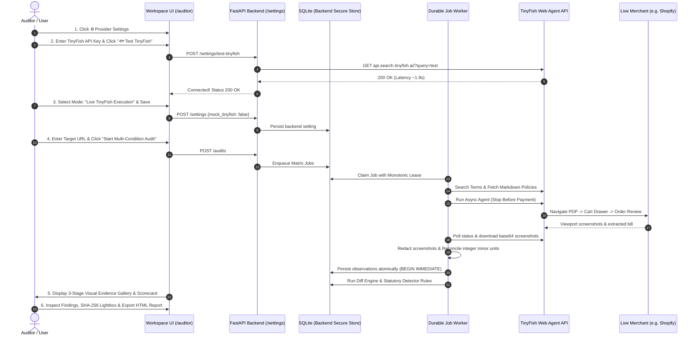

# 📡 Checkout Radar

> **Outside-In Checkout Flow Auditor & CCPA Dark Pattern Detector**  
> *AZINHACK 2026 Submission* · Team of 4

[]()
[]()
[]()
[]()

Checkout Radar audits e-commerce checkout funnels from the outside in. By executing identical checkout tasks across controlled variations (Delivery Pincode, Session History, Cart Value, and Observation Time) using **TinyFish** web agents, it extracts every itemized charge, deterministically diffs the flow, and produces timestamped, screenshot-backed evidence of potential dark pattern indicators mapped directly to the **CCPA 2023 Dark Pattern Guidelines**.

---

## 1. Problem & Positioning

Indian e-commerce and quick-commerce fees (handling, platform, convenience, surge, and small-cart fees) frequently appear late in the funnel or vary arbitrarily across sessions and locations. While the **Central Consumer Protection Authority (CCPA)** notified dark pattern guidelines in November 2023 prohibiting practices like *Drip Pricing* and *Basket Sneaking*, consumers, consumer-rights organizations, and journalists lack continuous, empirical auditing tools.

**Target Users:**
- **Consumers & Consumer Groups:** Continuous evidence gathering for grievance filings.
- **Journalists & Researchers:** Empirical data on fee inflation and deceptive flows.
- **Compliance Teams:** Outside-in auditing to ensure transparency standards before regulatory scrutiny.

*Hard Invariant:* Findings represent potential computational indicators, never judicial verdicts.

---

## 2. Core Method: The Condition Matrix

Checkout Radar uses **matched-pair differential auditing**—comparing runs that differ in *exactly one requested dimension*:

| Dimension | Reference Condition | Matched Comparison | Controls Kept Fixed |
|---|---|---|---|
| **Location Effect** | Pincode A (Tier-1) | Pincode B, C (Tier-2/3) | Session, Cart Tier, Recipe Family |
| **Session Effect** | Fresh Profile | Returning Profile | Pincode, Cart Tier, Recipe Family |
| **Cart Threshold** | Above Threshold (e.g. ₹998) | Below Threshold (e.g. ₹499) | Pincode, Session, Recipe Family |
| **Temporal Drift** | Time $t_0$ | Scheduled Re-observation $t_1$ | All Conditions & Cart Recipe |

### Cart Invariant & Separation of Recipe Family from Instantiated Cart
Changing cart quantity moves total value without altering unit prices. Checkout Radar separates:
- **Recipe Family:** Identical product IDs, variants, pricing context, and construction rules.
- **Cart Instance:** Quantity required to cross the threshold (e.g. 1 unit vs 2 units).
- **Rule Verification:** Quantity changes do **not** trigger `PRICE_VARIANCE`. A fee present only on the below-threshold side is reported as a legitimate `SMALL_CART_RULE`, not mistaken for a deceptive fee.

---

## 3. Architecture & Reliability

```
[ Dashboard (Web UI) ] ─── REST + SSE ───► [ FastAPI API ] ──► [ SQLite DB ]
                                                 │ enqueue         ▲
                                          [ Durable Jobs ] ────────┘
                                                 │
                  ┌──────────────────────────────┴──────────────────────────────┐
                  ▼                                                             ▼
         [ Matrix Orchestrator ]                                        [ Worker Daemon ]
                  │                                                             │
                  ├─► TinyFish Search (Merchant/Policy Discovery)               ├─► Diff Engine (5 Types)
                  ├─► TinyFish Fetch (Cached TTL Policy Extraction)             ├─► CCPA Rule Detectors
                  └─► TinyFish Agent (Async multi-condition runs)               ├─► Schema-validated LLM Classifier
                                                                                └─► Append-only Evidence Store
```

### Key Reliability Mechanisms
1. **Durable Job Table with Lease Recovery:** On worker startup or lease expiration, the system queries TinyFish for the existing `provider_run_id` before deciding to retry. Live runs are **never resubmitted**, avoiding duplicate credit usage.
2. **Deterministic First, LLM Last:** The deterministic diff engine and rule detectors produce candidate indicators; the LLM strictly classifies and contextualizes against CCPA legal text.
3. **Monetary Reconciliation in Integer Minor Units:** Every extraction is checked against:  
   $$\text{Subtotal} + \text{Charges} + \text{Taxes} - \text{Discounts} = \text{Final Payable}$$  
   If the equation fails, the run outcome is flagged `extraction_inconsistent` and excluded from diffs.
4. **Append-Only Evidence Store & Privacy Redaction:** Step screenshots are redacted for privacy (solid bottom-5% mask by default for sticky cookie/footer bars, with optional targeted bounding-box redaction for form fields), saved to disk, and verified with an immutable SHA-256 hash. *Architectural Audit Finding:* Fixed bottom-5% masking protects footers but leaves middle/upper form fields unmasked; targeted coordinate bounding boxes or full OCR pipelines are required for form-level PII.

---

## 4. TinyFish Integration Contract

TinyFish is central and in the main execution path:

| TinyFish API | Endpoint | Role in Checkout Radar |
|---|---|---|
| **Search API** | `GET https://api.search.tinyfish.ai` | Discovers merchant pricing policies, terms of service, and cancellation links in every demo audit. |
| **Fetch API** | `POST https://api.fetch.tinyfish.ai` | Extracts clean terms and conditions text with cached TTL freshness policy (`ttl: 0` for live pricing, `ttl: 3600` for policies). |
| **Agent API** | `POST https://agent.tinyfish.ai/v1/automation/run-async` | Runs multi-condition checkout automations with CCPA guardrails and output schema. |
| **Profiles API**| `POST/DELETE https://agent.tinyfish.ai/v1/profiles` | Creates isolated Browser Context Profiles per returning condition to prevent state leakage. |
| **Runs & Screenshots**| `GET /v1/runs/{id}`, `/runs/{id}/steps/{stepId}/screenshot` | Polls execution status and downloads step screenshot bytes. |

*Day-0 Spike Status:* **PASS** (All 6 core capabilities verified on live production account). See [docs/SPIKE_REPORT.md](docs/SPIKE_REPORT.md).

---

## 5. Five-Variant Demo Merchant Harness

The separate `harness` container provides 5 reproducible merchant checkout variants:

1. **Clean Merchant:** All delivery and handling charges disclosed upfront on the product page. *(Negative Control: Expected 0 findings)*
2. **Late Disclosure:** A ₹5.00 Handling Fee is concealed until the final checkout summary. *(Adversarial: Expected Drip Pricing indicator)*
3. **Add-on + Countdown:** A ₹15.00 Package Protection is checked by default and included in the total, alongside a timer that restarts every 30 seconds. *(Adversarial: Expected Basket Sneaking & False Urgency indicators)*
4. **Upfront Fee:** Mandatory convenience fee disclosed upfront on product page. *(Negative Control: Expected 0 findings)*
5. **Legitimate Threshold:** Free delivery above ₹500, flat ₹40 fee below ₹500. *(Negative Control: Reported as `SMALL_CART_RULE`, not deceptive)*

---

## 6. Evaluation & Benchmark Framework

Checkout Radar employs a three-tier evaluation methodology:

### Tier 1: Synthetic Scenario Benchmark — 45 Designed Fixtures (Rules-Only Unit Regression)
Deterministic acceptance suite verifying algorithm conformance against known dark pattern patterns:
- **15 Clean Bundles:** Negative controls across upfront fee, legitimate cart thresholds, and standard itemization.
- **12 Drip Pricing Bundles:** Mandatory fees disclosed late at checkout with verified absent upfront disclosures.
- **10 Basket Sneaking Bundles:** Pre-selected add-ons (insurance, donation, priority wrap) included in total payable.
- **8 False Urgency Bundles:** Controlled countdown resets (holding page and session fixed) and expiration anomalies.

```
Total Evaluated Fixtures: 45 synthetic bundles
Detection Performance: Precision 100%, Recall 100%, F1-Score 1.000 (0 false positives on negative controls)
Classification Conformance: 100% (30/30) on designed scenario fixtures
Note: Reflects deterministic regression conformance on designed test cases; does not represent uncurated production performance.
```

### Tier 2: Downstream LLM Verification, Semantic Guardrails & Statutory Explanation
The LLM does not alter detection boundaries; candidate indicators are strictly produced upstream by the deterministic diff engine. Only candidate findings from positive scenario bundles are queued for downstream classification ($N = 30$ candidates; the 15 clean bundles emit zero candidate indicators and zero outbound provider requests).

- **Execution Provenance:** Recorded live remote provider run (`openai/gpt-oss-20b` via Groq) against commit `0f2c227` with a clean working tree.
- **Persisted Telemetry Artifact:** Durably recorded in `evaluation/last_run_telemetry.json`. All reported metrics are calculated directly from this persisted record set via `calculate_metrics_from_records` and can be replayed anytime via `python3 evaluation/run_evaluation.py --from-telemetry evaluation/last_run_telemetry.json`.
- **HTTP Transport Round-Trips (Denominator = 30 Outbound Network Calls):**
  1. *Total Outbound Requests:* 30 calls (30 initial submissions; 0 corrective retries triggered).
  2. *HTTP Responses Received:* **30 / 30 (100.0%)** completed network round-trips returning an HTTP status code.
     - HTTP 200 OK: **2 / 30 (6.7%)**
     - HTTP 429 Rate Limit: **28 / 30 (93.3%)**
  3. *Network Transport Errors:* **0 / 30 (0.0%)** failed before HTTP negotiation (zero connection drops or DNS timeouts).
- **Model Output Coverage (Denominator = 30 Submitted Candidates):**
  4. *Initial Model Responses:* **2 / 30 (6.7%)** returned usable model completions on first attempt.
  5. *Initial HTTP Provider Errors:* **28 / 30 (93.3%)** HTTP 429 rate limit responses (safely routed directly to deterministic template fallbacks).
  6. *Corrective Retries Attempted:* **0** (max 1 retry; retries are triggered strictly by invalid model responses, not HTTP provider throttling).
  7. *Total Usable Model Outputs:* **2 / 30 (6.7%)** across all attempts.
- **First-Pass Raw Model Quality Gates (Denominator = 2 Received Responses):**
  8. *First-Pass Schema Validity:* **2 / 2 (100.0%)** raw JSON conformed to `ClassifiedFinding`.
  9. *First-Pass Non-Judicial Wording:* **2 / 2 (100.0%)** avoided adjudicative terminology.
  10. *Raw Model Category Concordance:* **2 / 2 (100.0%)** model independently agreed with candidate category before guards.
  11. *Raw Model Concept-Keyword Coverage:* **2 / 2 (100.0%)** cited CCPA statutory vocabulary before guards.
  12. *Initial Model Validation Failures:* **0 / 2 (0.0%)** rejected by runtime guardrails.
- **Post-Validation Acceptance & Pipeline Quality (Denominator = 30 Submitted Candidates):**
  13. *Deterministic Fallbacks Emitted:* **28 / 30 (93.3%)** safe pre-validated template fallbacks invoked (28 HTTP provider errors, 0 unrecovered validation failures).
  14. *Final Accepted Outputs:* **30 / 30 (100.0%)** verified compliant before persistence (2 model-derived + 28 fallbacks = 30 accepted).
  15. *Evidence Grounding Rate:* **30 / 30 (100.0%)** zero ungrounded absence claims or invented values.
  16. *Post-Guard Category Preservation:* **30 / 30 (100.0%)** enforced architectural invariant.
  17. *Post-Guard Pipeline Concept-Keyword Coverage:* **30 / 30 (100.0%)** full pipeline outputs include statutory Gazette terms.
- **Three-Dimensional Empirical Latency Profile:**
  - *Usable Model Response Latency (HTTP 200 completions, N = 2):* Mean: **1,508.1 ms**, Median: **1,508.1 ms**, p95: **1,977.7 ms** (raw samples: `[1977.7, 1038.5] ms`).
  - *All HTTP Round-Trip Latency (Includes HTTP 429 responses, N = 30):* Mean: **288.5 ms**, Median: **205.2 ms**, p95: **1,038.5 ms**.
  - *Candidate Processing Latency (End-to-End per Candidate, N = 30):* Mean: **2,395.2 ms**, Median: **2,205.0 ms**, p95: **3,039.1 ms** (includes inter-submission pacing, network calls, and fallback synthesis).
- **Methodological Scope & Disclosures:**
  - *Proven Resilience Under Rate-Limiting:* The 100% final output acceptance rate ($30/30$) reflects verified pipeline recovery via safe template fallbacks ($2\text{ model} + 28\text{ fallbacks}$), not 100% remote LLM availability.
  - *Descriptive Latency Sample:* With $N = 2$ successful model responses under severe upstream rate limits, reported model latency ($1,508.1\text{ ms}$) is a descriptive empirical measurement of this specific run, not an unconstrained baseline.
  - *Non-Conflation of Historical Runs:* Historical benchmark runs (e.g., 21/30 coverage or 19 model + 11 fallbacks) are distinct historical runs; the current benchmark artifact strictly reflects commit `0f2c227`.

### Tier 3: Independent Dual-Annotated Real-Site Dataset
- **Status:** **PENDING** — Scheduled for Day 4 (17 Oct 2026) per Section 13 milestone.
- **Protocol:** Two human annotators independently audit live Indian e-commerce checkout funnels. Inter-rater reliability (Cohen's Kappa) will be measured and reported prior to model scoring. See [docs/REAL_SITE_VALIDATION_PROTOCOL.md](docs/REAL_SITE_VALIDATION_PROTOCOL.md) for the complete non-destructive execution plan and safe stop-before-payment boundary.

### Evidence & Countdown Timestamp Provenance
All audit runs preserve empirical, timestamped evidence:
- **Controlled Countdown Procedure:** Observes timer at $t_0$, holds session and page fixed for $\Delta t = 30\text{s}$, and re-observes timer at $t_1$.
- **Timestamp Provenance:** Generates timezone-aware UTC timestamps at runtime when observations are captured. The elapsed duration is computed directly from timestamps ($t_1 - t_0$).
- **Evidence Linking & Provenance Tags:** Each observation is linked to supporting screenshot artifacts (`snapshot_id`), tagged with execution provenance (`provenance: "synthetic_mock_fixture"` vs `"live_agent"`), and annotated with non-judicial disclaimers.


---

## 7. Judge-Ready Quickstart Guide

Checkout Radar features a **one-command, cross-platform launcher** supporting Linux, macOS, and Windows. A fresh checkout runs the full audit pipeline in **deterministic offline mock mode by default**—requiring zero external API keys, zero LLM provider credits, and zero live merchant access.

### Prerequisites
- **Docker Engine & Docker Compose** (v2.20+ recommended or Docker Desktop).
- Git.

---

### 7.1 Single Launch Command

Clone the repository and run the launcher for your operating system:

```bash
# Clone the repository
git clone https://github.com/your-org/checkout-radar.git
cd checkout-radar
```

| Operating System | Command | Fallback / Direct CLI |
|---|---|---|
| **Linux & macOS** | `./start.sh` | `python3 scripts/launcher.py` |
| **Windows (CMD / PowerShell)** | `start.cmd` | `python scripts\launcher.py` |
| **Direct Docker Compose** | `docker compose up --build -d` | `docker compose up` |

#### What the Launcher Does Automatically
1. **Pre-Flight Diagnostics:** Verifies that Docker is installed, the daemon is active, and Compose is available.
2. **Zero-Configuration Environment:** If no `.env` file exists, automatically initializes one from `.env.example` with `MOCK_TINYFISH=true`.
3. **Container Build & Orchestration:** Builds and starts the 3 core services:
   - `harness`: 5-variant reproducible merchant server.
   - `api`: FastAPI backend, SSE stream engine, and static dashboard.
   - `worker`: Durable job daemon with monotonic lease fencing.
4. **Healthcheck Synchronization:** Polls service health endpoints until all containers report `healthy`.
5. **Dynamic Port Discovery:** Resolves mapped host ports automatically (handles custom or overridden ports without hardcoding).
6. **Automatic Browser Launch:** Opens the Auditor Dashboard in your default browser once the service is confirmed ready.

---

### 7.2 Service Endpoints

Once initialized, the services are available at:

| Component | Default URL | Description |
|---|---|---|
| **Product Landing Page** | [http://localhost:8000](http://localhost:8000) | Overview, CCPA regulatory background, detector capabilities, and one-click demo audit launcher cards. |
| **Auditor Investigation Workspace** | [http://localhost:8000/auditor](http://localhost:8000/auditor) | Full forensic auditing dashboard: executive scorecard, 3-stage visual evidence gallery, diffs, findings, technical timeline, and matrix selector. |
| **Demo Merchant Harness** | [http://localhost:8001](http://localhost:8001) | Controlled e-commerce store exhibiting the 5 behavioral variants. |
| **Interactive API Docs** | [http://localhost:8000/docs](http://localhost:8000/docs) | Swagger/OpenAPI documentation for all REST endpoints. |
| **Health Check** | [http://localhost:8000/health](http://localhost:8000/health) | Real-time service status, mock mode indicator, and key detection. |

*(Note: If port 8000 or 8001 is already bound, set `API_PORT` or `HARNESS_PORT` in `.env` or use `./start.sh`, which automatically detects dynamic port bindings).*

---

### 7.3 How to Run a Demonstration Audit (Judge Walkthrough)

Judges can explore Checkout Radar immediately using either the pre-seeded demonstration audits on the **Product Landing Page (`/`)** or by launching fresh live audits from the **Auditor Investigation Workspace (`/auditor`)**:

#### Option A: Inspect Pre-Seeded Demonstrations (Instant)
From the Landing Page at [http://localhost:8000](http://localhost:8000), click any of the 3 demonstration audit cards:

1. **Synthetic Positive Control (`aud_4d476bc71e63`):**
   - **Scenario:** E-commerce flow concealing a mandatory ₹5.00 Handling Fee until the checkout summary.
   - **Verdict:** `POTENTIAL INDICATORS DETECTED`.
   - **Finding Deduplication:** Scorecard displays `1 Unique (4 Runs)` (`1 pattern(s) confirmed across 4 condition observations`); the findings tab consolidates repeated matrix runs into a single card with `Observed in 4 of 4 Matrix Runs (100% Reproduction)` and a structured per-run trace strip.
   - **Evidence Gallery:** Shows synthetic offline DOM fixtures clearly labeled with analysis banners.

2. **Real-Site Negative Control (`aud_b29153cee0b1` — Headphone Zone):**
   - **Scenario:** Real-world Shopify merchant with upfront, tax-inclusive pricing.
   - **Verdict:** `VERIFIED CLEAN (UNDER TESTED FLOW)` with clear scope boundaries.
   - **Evidence Gallery:** Contains genuine 1280×720 viewport captures (`run_cf2137881ab6_*.jpg`) with immutable cryptographic SHA-256 digests.
   - **Lightbox:** Click `🔍 Full Resolution` to inspect high-resolution images in the modal.

3. **Inconclusive Audit Demonstration (`aud_f0946ab48e50`):**
   - **Scenario:** Obstructed checkout where checkout summary was missing.
   - **Verdict:** `INCONCLUSIVE AUDIT` (conservative fail-closed policy denying clean badges when proof is incomplete).

#### Option B: Launch a Live Multi-Condition Audit
1. Navigate to the Workspace at [http://localhost:8000/auditor](http://localhost:8000/auditor).
2. In the **Launch Checkout Audit** card, select a preset (e.g. **`2. Late Handling Fee`** or **`1. Clean Upfront`**).
3. Click **`Start Multi-Condition Audit`** and watch the real-time **SSE Audit Progress Console** as 4 condition runs execute.
4. Review findings, diffs, and evidence in the tabbed workspace.
5. Click **`📄 HTML Evidence Report`** for a self-contained offline report, or **`⚖️ CCPA Complaint Draft`** for a structured consumer grievance document.

---

### 7.4 Stopping the Application

To cleanly tear down running containers:

```bash
# Linux & macOS
./stop.sh

# Windows
stop.cmd

# Or using Docker Compose directly
docker compose down
```

---

### 7.5 Troubleshooting & Common Scenarios

- **Docker daemon is not running:**
  - *Linux:* Run `sudo systemctl start docker` (and optionally `sudo usermod -aG docker $USER`).
  - *macOS / Windows:* Launch Docker Desktop and wait until the whale icon shows "Engine running".
- **Port Conflict (Port 8000 or 8001 in use):**
  - Run with custom ports via environment variables:
    ```bash
    API_PORT=8080 HARNESS_PORT=8081 ./start.sh
    ```
- **Headless / Remote Server (No GUI / SSH):**
  - Pass `--no-browser` to suppress automatic browser launching:
    ```bash
    ./start.sh --no-browser
    ```
- **Inspecting Container Logs:**
  - View live or tail logs directly:
    ```bash
    ./start.sh --logs
    # or
    docker compose logs -f api worker
    ```
- **Checking Service Status:**
  ```bash
  ./start.sh --status
  # or
  docker compose ps
  ```

---

### 7.6 Verification & Test Suites

Checkout Radar includes a comprehensive, 100% reproducible test and verification suite requiring **zero external API calls**:

```bash
# 1. Local Pytest Suite (114 tests across 15 modules)
PYTHONPATH=backend pytest backend/tests/ -v

# 2. Docker Isolated Pytest Suite
docker compose run --rm api pytest tests/

# 3. Three-Flow Demonstration Verification (Synthetic Positive, Clean Negative, Inconclusive Fail-Closed)
python3 scripts/verify_demo_flows.py

# 4. Automated Browser Interaction & Lightbox CDP Verification
python3 scripts/verify_ui_interaction.py

# 5. Dedicated Security & Secret Scanner (147 files + full git history)
python3 scripts/scan_secrets.py
```

---

## 8. Live Merchant Auditing & Arbitrary Site Verification Guide

This section is a comprehensive, standalone guide for auditing any arbitrary e-commerce checkout flow using a live **TinyFish Web Agent** API key.

---

### 8.1 The Fresh-User Journey Overview

A user auditing a real website follows a 6-step outside-in workflow:



---

### 8.2 Configuring TinyFish Credentials via the UI

Checkout Radar features a **Zero-Exfiltration Architecture**: API keys are saved exclusively to the SQLite database on the backend and are **never** echoed to browser storage, JavaScript variables, logs, or exported reports.

1. **Open the Settings Modal:**
   - In the Auditor Workspace at [http://localhost:8000/auditor](http://localhost:8000/auditor), click the **`⚙️ Provider Settings`** button in the top navigation bar.
2. **Enter your TinyFish API Key:**
   - Locate the **TinyFish API Key** field.
   - Paste your key (e.g. `sk-tinyfish-...`).
   - *Note:* If a key is already configured on the server or in `.env`, the status badge shows `sk-...xxxx (Configured)`. You can leave the field blank to keep the existing key, or click `Clear Key` to remove it.
3. **Test the Connection:**
   - Click the **`🐟 Test TinyFish`** button in the modal footer.
   - Checkout Radar executes an isolated, timed test probe to `https://api.search.tinyfish.ai/?query=test`.
   - The status box will confirm connectivity:
     $$\text{CONNECTED (200 OK) } \cdot \text{ Latency: } \sim 1,900\text{ ms}$$
   - *Security Guarantee:* If an invalid key or network error occurs, the key is scrubbed from the error message using `redact_secrets()` before rendering.
4. **Activate Live Execution Mode:**
   - In the **Agent Execution Mode** dropdown, select:
     `Live TinyFish Execution (Requires TINYFISH_API_KEY)`
5. **Save the Configuration:**
   - Click **`Save Configuration`**. The modal closes and the backend is now actively configured for live agent dispatch.
6. **Confirm Live Mode is Active:**
   - Query the health endpoint in your browser or terminal at [http://localhost:8000/health](http://localhost:8000/health):
     ```json
     {
       "status": "healthy",
       "service": "checkout-radar-api",
       "mock_mode": false,
       "has_tinyfish_key": true,
       "has_llm_key": true
     }
     ```
   - When `mock_mode` is `false`, audits against external URLs will automatically invoke `RealTinyFishClient`.

---

### 8.3 Configuring an Optional LLM Provider (Optional Step)

> [!NOTE]
> **LLM classification is 100% optional.**  
> Detection of dark pattern indicators (Drip Pricing, Basket Sneaking, and False Urgency) is performed upstream by Checkout Radar's **deterministic diff engine and CCPA rule detectors**.

- **What happens when no LLM is configured?**
  Checkout Radar automatically invokes its pre-validated **deterministic statutory explanation templates**. These templates cite the exact sections of the CCPA 2023 Gazette Notification, format the price variance, and preserve all evidence links. Zero errors or ungrounded assertions occur.
- **Configuring an LLM for dynamic semantic contextualization:**
  1. In **`⚙️ Provider Settings`**, select a quick preset:
     - `⚡ Groq`: `https://api.groq.com/openai/v1` (`llama-3.3-70b-versatile`)
     - `🤖 OpenAI`: `https://api.openai.com/v1` (`gpt-4o-mini`)
     - `✨ Google Gemini`: `https://generativelanguage.googleapis.com/v1beta/openai` (`gemini-1.5-flash`)
     - `💻 Ollama / Local`: `http://localhost:11434/v1` (`llama3.2`)
     - `🛠️ Custom`: Any OpenAI-compatible `/v1/chat/completions` endpoint.
  2. Enter your LLM API key and click **`🔌 Test LLM`** to verify credentials and model latency.
  3. Set **Outbound Request Pacing** (default: `2.0` seconds) to prevent upstream rate-limiting (`HTTP 429`).
  4. Click **`Save Configuration`**.

---

### 8.4 Target Website & URL Compatibility Criteria

Checkout Radar audits public e-commerce stores from the outside in without requiring merchant cooperation, pre-installed tracking pixels, or developer API tokens.

#### Supported URL Types
- **Direct Product Display Pages (PDP):**
  - URLs pointing to an item with an active "Add to Cart" or "Buy Now" button.
  - Examples: Shopify stores, WooCommerce catalogs, Magento stores, BigCommerce sites, or custom headless retail sites with guest checkout.
  - **Authorized Reference Live Store:** `https://www.headphonezone.in/products/tangzu-waner-s-g`  
    *(Click the `🌐 Live: Headphone Zone` chip on the launch card to pre-fill instantly).*

#### Incompatible / Restricted Target Flows
To protect audit integrity and adhere to conservative fail-closed evaluation, certain flows cannot be fully audited:
1. **Mandatory Phone / SMS OTP Walls (Pre-Login Barriers):**
   - Quick-commerce apps (e.g. Blinkit, Zepto, Swiggy Instamart) require a physical Indian mobile number and an SMS OTP before rendering the cart or fee itemization.
   - *Outcome:* The agent halts immediately without requesting OTPs, records `blocked_by_login`, and classifies the audit as **`INCONCLUSIVE`**.
2. **Aggressive Bot Protection / CAPTCHA Challenges:**
   - Sites enforcing Cloudflare Turnstile, Datadome, or Google reCAPTCHA v2/v3 interstitial challenges.
   - *Outcome:* The agent records `blocked_by_bot` and routes to **`INCONCLUSIVE`**.
3. **Generic Homepages or Category Grid Pages:**
   - URLs without a direct product add-to-cart mechanism (e.g. `https://example.com/`) may cause the agent to wander or fail to reach checkout. Always supply a direct PDP URL.

#### Recommended Preset for Live Audits
- In the **Matrix Preset** dropdown, select **`Quick Preset`** (4 runs: Reference Tier-1 Pincode, Pincode B, Pincode C, and Below-Threshold Cart Tier).
- To run a minimal 1-run reference test against a live store via CLI:
  ```bash
  python3 scripts/run_real_audit.py
  ```

---

### 8.5 Launching the Audit & Following Progress

1. **Submit the URL:**
   - In the **Launch Checkout Audit** panel at `/auditor`, enter the target URL (e.g. `https://www.headphonezone.in/products/tangzu-waner-s-g`).
   - Select `Quick Preset`.
   - Click **`Start Multi-Condition Audit`**.
2. **Watch the Live Server-Sent Events (SSE) Stream:**
   - The launcher collapses and the **Active Forensic Audit** panel activates.
   - Expand the **`📡 Live Agent Event Stream`** accordion to observe execution telemetry in real time:
     - `run_started`: Condition initialized (e.g. pincode `110001`, fresh guest profile).
     - `search`: TinyFish Search queries merchant terms and pricing policy.
     - `fetch`: TinyFish Fetch retrieves clean markdown of shipping/cancellation policies.
     - `agent_submitted`: Async web agent dispatched to TinyFish cloud with CCPA goal prompt.
     - `agent_polled`: Agent executing browser clicks (navigating PDP, opening cart drawer, proceeding to checkout summary).
     - `finding_flagged`: Emitted immediately when a candidate dark pattern indicator is identified.
     - `run_completed`: All stage viewports sanitized and integer minor-unit math reconciled.
     - `audit_completed`: Final assessment evaluated and scorecards updated.

---

### 8.6 Inspecting Forensic Evidence & Reports

Once the audit reaches `Audit Completed`, inspect the tabbed workspace:

1. **Executive Scorecard (Top Hero Strip):**
   - **Observed Audit Verdict:** Displays `VERIFIED CLEAN (UNDER TESTED FLOW)`, `POTENTIAL INDICATORS DETECTED`, or `INCONCLUSIVE AUDIT`.
   - **Pricing Variance & Drip:** Quantifies difference between initial listed price and checkout payable in ₹ INR minor units.
   - **Dark Pattern Signals:** Deduplicated count of unique patterns and total occurrences across runs.
   - **Evidence Integrity:** Count of cryptographically verified screenshot artifacts.
2. **Tab 1: 📸 Journey Evidence Gallery:**
   - Displays viewports across the three funnel stages: **Stage 1 (Product Page)**, **Stage 2 (Cart Drawer / Page)**, and **Stage 3 (Checkout Summary)**.
   - Each card displays independent statuses: *Stage Execution* (`VERIFIED`), *Visual Capture* (`CAPTURED`), and *Pipeline Integrity* (SHA-256 digest).
   - **Condition Run Dropdown:** Switch between matrix runs to inspect how prices or delivery disclosures varied for different pincodes or cart values.
   - **Full-Resolution Lightbox:** Click **`🔍 Full Resolution`** on any card to inspect the unscaled capture, copy the SHA-256 hash, or download the raw JPEG.
3. **Tab 2: 🚨 Dark Pattern Findings & Diffs:**
   - Consolidates findings across runs with **Matrix Reproduction Rates** (e.g. *Observed in 4 of 4 Matrix Runs (100% Reproduction)*).
   - Click any finding card to expand:
     - CCPA 2023 Gazette definition and rule mapping.
     - Non-judicial statutory explanation.
     - Trace strip showing Run ID, Condition Key, Diff Reference, and clickable Evidence Snapshot links.
4. **Tab 3: 🔬 Technical Trail & Calls:**
   - Chronological audit log of every external operation (`search`, `fetch`, `agent_submit`, `agent_poll`, `screenshot`).
   - Displays timestamp, provider request ID, HTTP status code, and latency.
5. **Exporting Reports:**
   - **`📄 HTML Evidence Report`:** Standalone, self-contained report ready for legal counsel, compliance review, or investigative journalism.
   - **`⚖️ CCPA Complaint Draft`:** Pre-structured grievance draft adhering to the National Consumer Helpline / CCPA complaint format.

---

### 8.7 Safety Guardrails & Outcome Interpretation

Checkout Radar enforces strict ethical, legal, and operational guardrails:

#### The Non-Destructive Invariant: STOP BEFORE PAYMENT
> [!CAUTION]
> Under no circumstances does Checkout Radar place orders, enter financial credentials, or transfer money.
- The web agent is instructed with strict negative prompts:
  `STOP IMMEDIATELY BEFORE ANY FINAL PAYMENT OR ORDER CONFIRMATION STEP. NEVER CLICK PAY NOW, COMPLETE ORDER, OR SUBMIT PAYMENT.`
- The audit terminates strictly upon capturing the itemized order summary (item subtotal, taxes, shipping, handling fees, and payable total).
- No merchant inventory is reserved and zero payment gateways are triggered.

#### How to Interpret Audit Verdicts
| Outcome | Regulatory Meaning | When Emitted |
|---|---|---|
| **`VERIFIED CLEAN (UNDER TESTED FLOW)`** | Bounded Clean Finding | All required stages (product, cart, checkout summary) were captured, inspected, and verified transparent with ₹0 hidden fees and 0 dark patterns. *Explicitly does not certify uninspected payment gateways or untested payment methods.* |
| **`POTENTIAL INDICATORS DETECTED`** | Candidate Dark Pattern Flagged | Empirical evidence confirms a discrepancy: mandatory fee introduced late (*Drip Pricing*), pre-selected optional fee included in total (*Basket Sneaking*), or reset countdown timer (*False Urgency*). |
| **`INCONCLUSIVE AUDIT`** | Incomplete / Obstructed Audit | Checkout summary could not be reached or verified (e.g. phone OTP wall, CAPTCHA, server error, or network drop). **Conservative Fail-Closed Rule: Missing evidence is NEVER treated as proof that a site is clean.** |

---

### 8.8 Troubleshooting & Edge Cases

| Symptom | Cause | Resolution |
|---|---|---|
| **Test TinyFish returns HTTP 401 Unauthorized** | The configured API key is invalid, inactive, or expired. | Check your TinyFish API key. Open `⚙️ Provider Settings`, paste the correct key, and click `🐟 Test TinyFish` to verify before saving. |
| **Test TinyFish returns HTTP 403 Forbidden** | The TinyFish account does not have access to Web Agent or Search APIs. | Verify that your TinyFish plan includes Agent and Search endpoints, or contact TinyFish support. |
| **Agent run times out polling** | The target website took longer than expected to load or solve DOM steps. | Increase polling timeout via environment variable `TINYFISH_MAX_POLLS=90` (default: 60 polls $\times$ 5s = 300s). |
| **Audit outcome is `INCONCLUSIVE`** | The merchant site enforced a mandatory phone OTP or Cloudflare challenge before checkout. | This is expected and honest behavior. Review the *Inconclusive Factors* list in the assessment banner. The site cannot be certified clean without bypassing authentication walls. |
| **Port conflict on startup (`8000` or `8001` already in use)** | Another application on your machine is using port 8000 or 8001. | Launch with custom port overrides: `API_PORT=8080 HARNESS_PORT=8081 ./start.sh`. |
| **Docker daemon unavailable** | Docker Desktop is not started or systemd service is inactive. | Start Docker Desktop (macOS/Windows) or run `sudo systemctl start docker` (Linux). |
| **LLM returns HTTP 429 Too Many Requests** | Groq or OpenAI free-tier rate limits exceeded. | Increase request pacing to `3.0` or `4.0` seconds in `⚙️ Provider Settings`. Alternatively, Checkout Radar automatically uses deterministic statutory templates with zero impact on audit validity. |
| **Switching back to Offline Mock** | You want to run tests or demos without consuming TinyFish credits. | In `⚙️ Provider Settings`, set *Agent Execution Mode* to `Deterministic Offline Mock (Zero Credits)` and save. |

---

## 9. API Surface

| Endpoint | Method | Purpose |
|---|---|---|
| `/audits` | `POST` | Submit URL and matrix preset (`quick` or `full`). |
| `/audits` | `GET` | List past audits with run and finding counts. |
| `/audits/{id}` | `GET` | Detailed audit status, conditions, and runs. |
| `/audits/{id}/stream`| `GET` | Live Server-Sent Events (SSE) agent progress feed. |
| `/audits/{id}/diff` | `GET` | Deterministic matched-pair diff results. |
| `/audits/{id}/findings` | `GET` | CCPA-mapped dark pattern candidate indicators. |
| `/audits/{id}/report` | `GET` | Exportable standalone HTML evidence report with SHA-256 hashes. |
| `/audits/{id}/complaint-draft` | `POST` | Generates CCPA consumer grievance draft (Draft only; never auto-submitted). |
| `/audits/{id}/reobserve` | `POST` | Triggers manual temporal re-observation across time. |
| `/audits/{id}/provider-calls` | `GET` | Complete log of all Search, Fetch, Agent, and Screenshot calls. |
| `/settings` | `GET` | Retrieve public provider configuration with all secrets safely masked. |
| `/settings` | `POST` | Update LLM base URL, model, pacing, mode, and backend credentials securely. |
| `/settings/test-llm` | `POST` | Execute isolated, timed connectivity test with sanitized error reporting. |
| `/settings/test-tinyfish` | `POST` | Execute isolated, timed TinyFish connectivity check with sanitized error reporting. |
| `/health` | `GET` | Real-time service status, mock mode indicator, and key detection. |

---

## 10. Declared Code Reuse & Dependencies

Checkout Radar was designed and developed originally for AZINHACK 2026. Standard open-source libraries used:
- `FastAPI`, `Starlette`, `Uvicorn` — Web framework and ASGI server
- `Pydantic` — Contract validation and schema generation
- `Pillow` — Image redaction and privacy masking
- `SQLite3` (Standard Library) — Append-only durable database with WAL mode
- `pytest`, `httpx` — Automated unit, diff, and evaluation testing

---

## 11. Legal & Ethical Disclaimer

Findings generated by Checkout Radar represent algorithmic candidate indicators of potential deceptive practices under the CCPA Guidelines for Prevention and Regulation of Dark Patterns, 2023. They do not constitute judicial rulings, formal legal determinations, or statutory liability.

