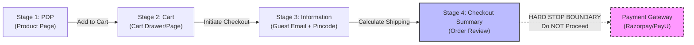

# Real-Site End-to-End Validation Protocol (Non-Destructive)

## 1. Executive Summary

This document specifies the end-to-end execution protocol for conducting an outside-in checkout audit on an active Indian public retail e-commerce merchant.

### Constraints & Invariants
- **No live API quota consumed during preparation**: Designed without making external TinyFish or Groq calls until explicitly authorized.
- **Strictly non-destructive**: No orders are placed, no payment gateways are triggered, no credit card or UPI credentials are sent, and no merchant inventory is held.
- **Defensive Outcome Classification**: Uninspected stages, bot blockers, or mandatory OTP walls produce `inconclusive` audit records rather than misleading clean or violation claims.
- **Auditable Evidence Provenance**: Every extracted charge, discount, and timer is linked to verified stage captures with immutable SHA-256 screenshot hashes.

---

## 2. Target Site Identification & Profile

| Parameter | Specification |
| :--- | :--- |
| **Merchant Name** | Headphone Zone (`headphonezone.in`) |
| **Alternative Candidate** | Blue Tokai Coffee Roasters (`bluetokaicoffee.com`) |
| **Platform Architecture** | Shopify Plus (Custom Headless / Liquid Theme) |
| **Jurisdiction & Legal Context** | India (CCPA 2023 Guidelines on Prevention and Regulation of Dark Patterns) |
| **Currency & Settlement** | INR (Indian Rupee, ₹), minor units (paisa) |
| **Catalog Access** | Publicly accessible catalog without mandatory pre-login |
| **Checkout Flow Type** | Standard multi-step checkout with guest support |
| **Why Suitable** | 1. Transparent stage progression: Product Display Page (PDP) &rarr; Cart Drawer &rarr; Information & Shipping &rarr; Payment.<br>2. Pincode-based delivery fee computation.<br>3. Does not enforce mandatory pre-authentication to inspect price disclosures. |

---

## 3. Expected Navigation Path & Stage Captures



### Stage 1: Product Display Page (PDP)
- **Target URL**: `https://www.headphonezone.in/products/tangzu-waner-s-g`
- **Actions**:
  1. Load URL in clean browser context (headless Chromium).
  2. Capture full-page screenshot (`step_name: "product"`).
  3. Extract upfront displayed price: e.g. `₹1,499.00` (149,900 minor units).
  4. Inspect text for disclosures:
     - Check for "Inclusive of all taxes" or tax disclaimers.
     - Check for upfront delivery notices (e.g. "Free shipping on orders above ₹999").
     - Check for any stated mandatory handling, platform, or convenience fees.
  5. Record stage capture: `capture_status: "verified"`, `inspection_status: "inspected"`.

### Stage 2: Cart Page / Drawer
- **Actions**:
  1. Click `Add to Cart` (`button[name="add"]`).
  2. Navigate to `/cart` or open cart drawer.
  3. Capture screenshot (`step_name: "cart"`).
  4. Inspect itemized subtotal (`subtotal_minor`).
  5. Inspect for auto-injected addons:
     - Check for pre-selected checkboxes (e.g. "Priority Shipping Insurance", "Transit Protection", "Gift Packaging").
     - If pre-selected addon is found, record `preselected_addons` indicator.
  6. Record stage capture: `capture_status: "verified"`, `inspection_status: "inspected"`.

### Stage 3: Contact & Shipping Information
- **Actions**:
  1. Click `Checkout` button (`button[name="checkout"]` or `a[href*="/checkout"]`).
  2. Input guest contact details:
     - Synthetic email: `auditor.research@checkoutradar.internal`
     - Synthetic recipient: `Checkout Auditor`
  3. Input destination address:
     - Address line: `Flat 101, Connaught Circus`
     - Destination Pincode: `110001` (New Delhi, Central)
  4. Wait for dynamic rate calculation (Shopify AJAX rate query).

### Stage 4: Checkout Summary (Order Review)
- **Actions**:
  1. Capture full checkout summary screenshot (`step_name: "checkout_summary"`).
  2. Extract complete price breakdown:
     - Item Subtotal (`subtotal_minor`)
     - Shipping / Delivery Fee (`shipping_fee_minor`)
     - Platform / Convenience / Handling Fee (`handling_fee_minor`)
     - Tax Breakdown (`tax_minor`)
     - Final Payable Total (`final_payable_minor`)
  3. Reconcile total:
     $$\text{Final Payable} = \text{Subtotal} + \text{Charges} + \text{Taxes} - \text{Discounts}$$
  4. Record stage capture: `capture_status: "verified"`, `inspection_status: "inspected"`.

---

## 4. Access Restrictions & Authentication Barriers

| Barrier Scenario | Detection Mechanism | Enforcement & Audit Outcome |
| :--- | :--- | :--- |
| **Mandatory Phone OTP Wall** | Input field matching `input[autocomplete="one-time-code"]` or iframe modal (Gokwik, Shopflo, OTPless). | **Audit Halted.** Invokes `assess_audit_outcome(is_blocked_by_login=True)`. Returns outcome `inconclusive`, code `blocked_by_login`. Never sends automated SMS requests or synthetic OTPs. |
| **Bot Detection / CAPTCHA** | Cloudflare Turnstile, Google reCAPTCHA v2/v3, or Datadome challenge screen. | **Audit Halted.** Emits outcome `inconclusive`, code `bot_detection`. Prevents false "clean" or "violation" classifications. |
| **Pincode Delivery Blackout** | "Delivery not available for pincode 110001". | Condition marked `condition_not_applied`; audit routes to inconclusive. |
| **Guest Checkout Allowed** | Standard email and address fields rendered; navigation reaches order summary. | Audit proceeds through Stage 4. |

---

## 5. Non-Destructive Safe Stop-Before-Payment Boundary

> [!CAUTION]
> Under no circumstances may the automated auditor click payment execution buttons or submit payment credentials.

### Strictly Prohibited Actions
1. **Never click payment finalization buttons**:
   - `button:contains("Pay Now")`
   - `button:contains("Complete Order")`
   - `button:contains("Place Order")`
   - `button[name="gateway-submit"]`
   - `div.razorpay-payment-button`
   - Form submission actions pointing to `api.razorpay.com`, `secure.payu.in`, `cashfree.com`, or `billdesk.com`.
2. **Never enter payment credentials**:
   - No credit card numbers, CVVs, expiration dates, UPI Virtual Payment Addresses (VPAs), or Net Banking login credentials.
3. **Hard Stop Boundary**:
   - The audit strictly terminates immediately upon rendering the itemized order summary on the checkout page before payment gateway redirection.

---

## 6. Exact Observations Needed to Validate Drip Pricing

To validate the **Drip Pricing** detector (CCPA 2023 Annex 1.8), Checkout Radar requires the following empirical evidence chain:

### Observation A: Upfront Stage (`product`)
```json
{
  "step_name": "product",
  "step_index": 1,
  "stage_capture": {
    "capture_status": "verified",
    "inspection_status": "inspected",
    "snapshot_id": "snap_pdp_001"
  },
  "charges": [
    {
      "label": "Tangzu Wan'er S.G",
      "canonical_label": "item_price",
      "amount_minor": 149900,
      "step": "product",
      "mandatory": "yes"
    }
  ],
  "disclosures": [
    {
      "stage": "product",
      "text": "Inclusive of all taxes",
      "verified_negative_extra_fees": true
    }
  ]
}
```

### Observation B: Final Stage (`checkout_summary`)
```json
{
  "step_name": "checkout_summary",
  "step_index": 3,
  "stage_capture": {
    "capture_status": "verified",
    "inspection_status": "inspected",
    "snapshot_id": "snap_chk_001"
  },
  "charges": [
    {
      "label": "Tangzu Wan'er S.G",
      "canonical_label": "item_price",
      "amount_minor": 149900,
      "step": "checkout_summary",
      "mandatory": "yes"
    },
    {
      "label": "Order Processing Fee",
      "canonical_label": "handling_fee",
      "amount_minor": 4900,
      "step": "checkout_summary",
      "mandatory": "yes"
    }
  ],
  "totals": {
    "subtotal_minor": 149900,
    "charges_minor": 4900,
    "taxes_minor": 0,
    "discounts_minor": 0,
    "final_payable_minor": 154800
  }
}
```

### Detector Evaluation & Output Chain
1. **Diff Engine Evaluation**:
   - Detects `handling_fee` (₹49.00) first seen at step 3 (`checkout_summary`).
   - Expected disclosure step: step 1 (`product`).
   - Verified negative capture check: `step_name: "product"` capture was `verified` and `inspected`, and disclosure was absent.
   - Generates diff: `type: "LATE_DISCLOSURE"`, `category: "drip_pricing"`.
2. **Deterministic Detector**:
   - `detect_drip_pricing_indicators` flags candidate finding:
     - `category`: `drip_pricing`
     - `severity`: `high`
     - `confidence`: `0.95`
     - `evidence_ids`: `["snap_pdp_001", "snap_chk_001"]`
3. **Statutory Explanation (Template Fallback or Guardrailed LLM)**:
   - Evaluates against CCPA 2023 Guidelines, Annex 1.8.
   - Non-judicial framing: "Potential indicator of drip pricing observed: mandatory Order Processing Fee of ₹49.00 was first introduced at the checkout summary stage without prior disclosure on the product page."
4. **Outcome Assessment**:
   - `assess_audit_outcome` returns `potential_indicators_detected`.

---

## 7. Execution Checklist & Pre-Flight Verification

Before running this protocol against a live public retail site:

- [ ] Confirm explicit authorization to initiate live web auditing.
- [ ] Ensure `MOCK_TINYFISH` is disabled only for the authorized audit target.
- [ ] Verify rate limiter and request pacing (`LLM_PACING_SECONDS >= 2.0`).
- [ ] Confirm `stop_before_payment` invariant is active in the browser navigation script.
- [ ] Check evidence directory disk write permissions (`data/evidence`).
- [ ] Ensure test environment does not contain hardcoded credentials or API keys.
